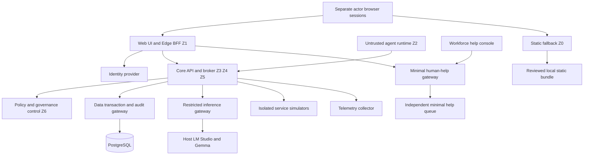

# Context and system architecture

## Mission and boundaries

The service helps clients, carers and crisis workers reach appropriate support with accurate context, informed choice and reduced administrative burden. Actors use AI assistants to retrieve, organize, draft and coordinate; qualified humans retain clinical responsibility. Current operation is private, synthetic, role-played and non-clinical. No police account, brief recipient, connector, credential, partnership or automated emergency contact exists. The denied EMS simulator is a negative-test target only, never a callable emergency tool.

Outside the system: human participants, private browser devices, GitHub review, the local host runtime, and independently verified content publication. Real service providers, public carrier gateways, clinical integrations, real person records and public deployment are not connected. Real participant authentication metadata is necessary and is separated from synthetic business data.

## Architectural choices

Use a modular deterministic service core with separately isolated untrusted runtime and inference gateway, rather than a microservice per model element. Select React/TypeScript, Python/FastAPI, PostgreSQL, Keycloak/OIDC/MFA and OPA/Rego as proposed in requirements. A small explicit state machine coordinates tasks. Docker images run in local single-node Kubernetes; host LM Studio runs Gemma 3 4B IT. No autonomous browsing, code execution, dynamic tools or remote inference.

Arrows describe logical allowed request dependencies, not universal port access. Responses on established connections are implicit. Core-owned dispatch workers poll the core command API; they do not get arbitrary DB or partner access. Subsystem replication is not high availability on one host.

## Deployables and authority

| Deployment | Owned subsystems | Authority / persistence |
|---|---|---|
| `web-edge` | Role UI, channel adapters, BFF/session cookies, transport | No business permission authority; server-side authentication and input limits |
| `identity` | Keycloak realm, MFA, account lifecycle | Human credential truth; own isolated identity database role |
| `core-api` | Sessions, assertions, broker, capability registry, assessment, directory, plans, consent views, queue, referral, task coordination | Deterministic business transitions through command gateway; no raw DB credential |
| `core-jobs` | Outbox dispatch, follow-up, expiry, reconciliation | Narrow workload scopes; all actions re-enter core enforcement |
| `agent-runtime` | Role-scoped plan/proposal processing | No durable store/secret/capability access; broker-only egress |
| `inference-gateway` | Model identity/capacity/request adapter | Only approved inference path; no clinical or tool authority |
| `policy-control` | OPA evaluator, verified bundle loader, activation/revocation controller | Decision generation and signed activation management; no ability to approve own bundle |
| `data-gateway` | Scoped repositories, command transaction, audit append/read, event log | Sole app persistence boundary; distinct DB login roles and narrow stored-procedure grants |
| `postgres` | Business, control, audit and identity databases/schemas | Durable storage, constraints and transactional revisions; isolated credentials |
| `help-gateway` | Minimal human-help request, workforce acceptance and independent spool | Fixed narrow authorization; no clinical content/history access |
| `simulators` | MCRT/navigator, handoff, generic recipient, directory feed, channels, denied EMS target | Synthetic state only; no internet egress |
| `telemetry` | Collector, metrics store and operational dashboard | Observe health; no ability to authorize actions |
| Host fallback | Content-only static server and separate publication | No application identity, cluster, database or policy dependency |

Release registry, audit reader and operator consoles are modules with distinct API scopes; splitting deployment later requires the same interfaces and least privilege. The data gateway is a privileged trust boundary whose compromise can defeat application checks; database roles, procedures, audit checkpoints and host access restrictions reduce but do not eliminate that risk.

## Permitted network paths

Default deny applies to ingress and egress. Explicitly allow browser→private edge/identity; edge→core/help; runtime→broker endpoints only; core→policy/data/inference/simulator; jobs→core; help-console→help; data→specific PostgreSQL roles; policy→control repository through data; designated workloads→telemetry and necessary private DNS. Identity alone reaches its database. Inference gateway alone reaches the pinned host model endpoint. Simulator dependencies are isolated; denied EMS target has no agent/core business route. Health/administrative endpoints use separate identities and routes.

No runtime→identity, store, policy, simulator, host inference, Kubernetes API or internet. Network rules do not authorize an HTTP method: mTLS identity and endpoint-specific PEPs restrict the runtime to broker task/proposal/inference operations. No blanket intra-namespace allow. CNI host-network behavior, DNS and IPv6 require deployed probes. Host and cluster root remain powerful residual adversaries.

> This prototype demonstrates control and containment architecture using non-clinical stub logic and synthetic data. It provides no evidence of clinical safety, triage validity, or equity performance, and must not be cited as such.
