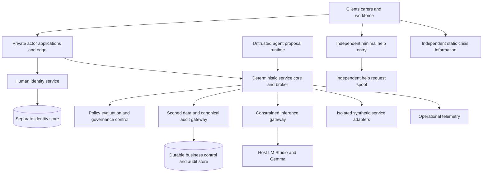

# System context and architectural structure

## Service mission and system boundary

CARE-Link supports timely meaningful human connection and appropriate verified service pathways while preserving client autonomy and reducing avoidable actor administration. Client/PID and carer needs drive the workflow; AI assists rather than owning a person or making clinical determinations. Worker and receiving-service decisions remain distinguishable from model proposals and automated technical execution.

The demonstrator operates privately for authorized adult project participants role-playing fictional cases, with synthetic person-related business data and non-clinical rules/content. Real authentication account metadata is separated from those personas. Ottawa/Ontario is the implementor/deployment context; users provide their applicable jurisdiction and fictional service scenarios use CA-XX/CA-YY. Residence or IP is not location/identity assurance.

Inside the boundary are actor applications, session/domain services, bounded AI coordination, deterministic policy and access enforcement, knowledge and plan services, workforce coordination, simulated receiving services, storage/audit, operational controls and independent help/static publication. Outside are participant devices, the host infrastructure, GitHub human review, official content sources and future real service partners. Only reviewed static crisis information is real service content. There is no real police-facing actor, contract, connector, brief workflow, analytics integration or autonomous emergency-contact capability. A denied emergency target exists solely for controlled negative tests and cannot be selected as a business tool.

## Logical architecture

The direct client/workforce links to host help/static paths are intentional: they do not traverse the main edge, cluster, model or business store. This minimal channel can record an authenticated opaque help request when its own trust/storage are healthy; it does not replace protected conversation, guarantee a staffed worker or survive whole-host failure. Logical dependencies do not imply blanket network access; response traffic is implicit and every protected request is mediated.

## Component responsibilities and authority

| Component | Owns / principal inputs and outputs | Authority and dependency boundary |
|---|---|---|
| Actor applications and edge | Role workspaces, disclosures, browser session/transport, channel normalization; user commands and authorized views | No client-side permission authority; human credential checks and input controls at edge |
| Human identity service | Accounts, MFA, login/step-up and revocation evidence | Authentication truth only; no PID ownership, workforce assignment or consent authority |
| Service core and broker | Sessions/assertions, fixture assessment, rationale, plans/consent/directory, workforce/referral/follow-up workflows | Owns deterministic domain transitions and tool mediation; no raw model-to-store or browser-to-store path |
| Task coordinator and proposal runtime | Core owns durable goals/review/progress; runtime proposes steps from scoped context and observations | Runtime untrusted for authority, no store/partner credentials, broker-only egress |
| Inference gateway | Model identity, bounded compute and host endpoint adaptation | Sole model-server path; generates no service permission or clinical truth |
| Policy evaluation and governance control | Deterministic rules, approved bundle/version activation, revocation and safe-mode state | Decisions constrained by immutable scope limits and independent human approvals |
| Data and audit gateway | Scoped projections, durable domain/control transitions, canonical audit and reliable work intent | Sole application persistence boundary; differentiated writers/readers; root compromise remains residual |
| Workforce and receiving-service interfaces | Assignment, observation/takeover, receiving inbox and explicit confirmations | Human acceptance/connection is evidence, never inferred from model text or request submission |
| Simulated adapters | Fictional intake, handoff, directory feeds, channels and receipt observations | Isolated external-behaviour boundary; cannot fall back to live services |
| Operational plane | Health, incident/evidence/aggregate reporting and controlled releases | Observes and invokes explicitly scoped controls; monitoring does not grant permission |
| Independent help and static publication | Minimal request acknowledgement and separately reviewed public content | Own host trust/storage/publication, no business history; static path has no auth dependency |

Grouping related core modules limits distributed complexity while preserving explicit authority boundaries. Runtime, inference, identity, persistence, control and help remain isolated where credentials, trust or failure independence differ. A module is not automatically a microservice, and a namespace does not establish an independent failure domain.

## Architectural rules

Each important state has one owner: identity authenticates, workforce owns assignment, consent/subject services own disclosure grants, deterministic fixture assessment owns committed stub tier, directory owns verified service facts, human reviewers approve exact proposals, broker/domain services enforce execution and audit records what happened. A model-derived assertion never becomes a grant, identity or sourced fact without the appropriate independent process.

Human and service requests share authorization principles but retain distinct identities. Core-owned jobs reenter current authorization at execution; they do not get blanket database or connector rights. Protected disclosure/execution is ordered against authoritative revocation/control state, with explicit irreversible boundaries. No promise of instantaneous distributed revocation or end-to-end exactly-once transmission is made.

The trust/connectivity policy denies unspecified dependencies. Runtime reaches only broker interfaces, inference gateway reaches only approved host inference bridge, data gateway alone reaches business store, identity uses a separate identity store, and simulators have no live-service/internet egress. Workload mTLS authenticates these connections; application policies restrict methods, resources, purpose and fields. Mesh implementation and local networking capability remain decisions requiring evidence, not inferred from diagram arrows.

> This prototype demonstrates control and containment architecture using non-clinical stub logic and synthetic data. It provides no evidence of clinical safety, triage validity, or equity performance, and must not be cited as such.
