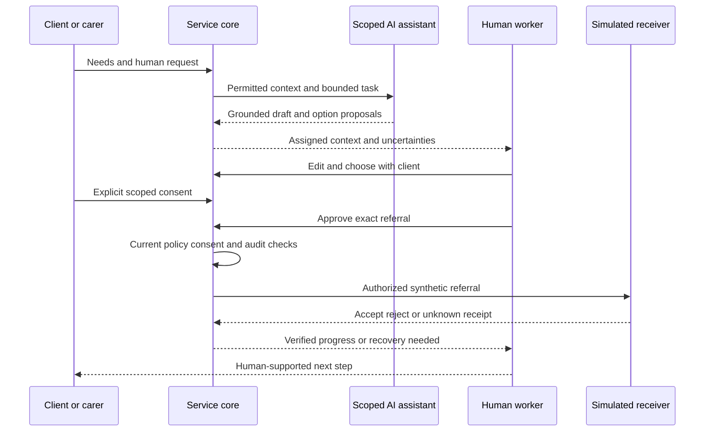

# Actors and end-to-end service workflows

## Actor responsibilities and workspaces

Each actor instance has its own issued credential, scoped session and auditable identity. Participant role indicates how the person is engaging; it does not grant professional/workforce powers. Actual account identity is distinct from the synthetic PID or carer record. Every workspace exposes its own useful actions and permitted assistance; ownership/assignment/field restrictions are enforced server-side.

| Actor | Service workspace and AI assistance | Decisions retained by actor / restrictions |
|---|---|---|
| PID/client participant | Express needs, correct/disagree, compare verified options, plan/preferences/sharing, private help; assistant organizes information and questions | Client chooses/declines optional pathways and sharing within authority; no inferred consent or diagnosis |
| Carer | Attributed report, permitted plan information, carer coaching/navigation and own support; assistant prepares context and questions | Relationship alone grants no PID/youth content access or grantor authority |
| Professional participant | Professional-context intake and attributed observations | Participant entitlement does not create worker access |
| Crisis worker | Assigned conversation, context pack, missing/conflicting facts, protocol lookup, editable drafts and referral review | Worker verifies facts, chooses professional next steps, authors/accepts final communications and confirms human control |
| Supervisor | Scoped observation, assignment/takeover, aggregate demand and workload support | Explicit case access; no individual exposure/performance ranking |
| Receiver / community navigator | Own service inbox, consented package, clarification/accept/reject/receipt; assistant checks completeness and logistics | Receiving actor alone confirms acceptance/capacity; no access to full source conversation or other services |
| Operator | Health, safe-mode/kill, release/rollback proposals and recovery status; assistant retrieves runbooks and drafts incident context | No standing business-content access or self-approval |
| Security reviewer | Scoped events, quarantine, bounded adversarial tests and containment review | No default transcript browsing; discretionary recovery requires authority |
| Governance reviewer | Classified artifact change, evidence/exception review and exact-digest approval | Independent human approval within authority; AI review cannot substitute |
| Auditor / equity analyst | Purpose/time-bound audit and aggregate/evidence views | Read-only; content only with explicit scoped grant; coupled metrics and aggregation limits |
| Trainer / project role-player | Fictional scenarios, internal channel/service conditions and reviewed debrief | Adult consent/safeguarding; no AI clinical-competence certification or live partner contact |

All workspaces share accessible navigation, EN/FR reviewed interface content, plain-language status, explicit AI/stub labels, source/unknown/conflict distinctions, and human-help/static links. Crisis interaction supports interrupted/low-bandwidth use without requiring acceptance of AI suggestions. Synthetic channel/interpretation exercises are not proof of full carrier/relay or language equivalence.

## Normal journey: from request to meaningful handoff

1. A carer enters the private application, receives AI/demo/confidentiality disclosure and identifies role and user-provided fictional jurisdiction. Optional identifying/community preferences are not required for service. The core records reported facts with attribution and missing/unknown/deferred assessment items.
2. Deterministic fixture hazard/escalation handling runs before optional model work. A scoped assistant gathers permitted context, queries verified fictional directory records and proposes useful clarifying questions/options. Rationale uses controlled structured/source content, not hidden model reasoning. Client corrections/disagreement remain visible and cannot cancel mandatory human routing.
3. Human help is requested by user choice or deterministic protocol. Queue service records the request and actual operating state; acknowledgement is not a promised wait or connection. While waiting, permitted accompaniment and reviewed templates remain available, and fixture reassessment can identify changed needs.
4. An eligible worker accepts assignment and receives the authorized context pack, including source-attributed facts, plan preferences, unknowns and conflicts. Worker reviews AI suggestions, asks/corrects facts and can work manually. Acceptance/handoff confirmation establishes who controls conversation; supervisor takeover invalidates stale agent/previous-worker output.
5. Worker and client compare qualified options, including the scenario’s explicit operating envelope, freshness, source uncertainty, fallback and third-party police-involvement qualifications. Independence of CARE-Link never implies a guarantee about a third party. Decline/alternate choice is a separate supported action.
6. A referral draft enumerates recipient, purpose, fields and provenance. The authorized subject/grantor supplies granular consent; worker approves the exact reviewed proposal. Deterministic services recheck current rights, consent, source state and policy before the adapter sends to the isolated receiver.
7. Receiver/navigator reviews the permitted package, asks clarification or accepts/rejects. Assistant can check the receipt and propose alternatives after failure, but cannot invent acceptance, arrival or a connected worker. Refusal/timeout keeps support active; uncertain delivery is reconciled before retry.
8. Outcome records distinguish recommended, chosen, attempted, accepted, connected, declined and unknown. Separate contact consent enables a post-crisis internal follow-up offer and carer-directed support. Client-led plan updates/sharing carry attribution and revocation. Service quality is evaluated by verified options, meaningful human connection, critical accuracy and client agency—not chat volume.

## Other principal journeys

**Direct PID and pre-crisis planning:** PID leads needs/preferences and plan construction; assistant organizes approved content and authored wishes. Sharing is granular and revocable. Conflicting carer/worker reports are preserved rather than silently resolved, with safety-relevant conflict routed for human review.

**Youth or uncertain age:** adult testers may role-play youth scenarios. Core/broker mediation requests qualified project human help and offers a discreet private session where the channel permits. Contacting adult does not inherit access. Real youth legal/capacity/reporting rules remain disabled pending appropriate review; an engineering stub is never presented as legal approval.

**Overload or unavailable worker:** queue has normal/elevated/severe/partner-unavailable/regional-outage modes. Unknown staffing means unknown wait. Assistance and periodic protocol-driven review continue where dependencies permit; a service gap is reported honestly and never silently becomes a police/emergency connector.

**Follow-up, burnout support and learning:** separately consented internal follow-up checks outcomes and carer-directed support; actor-only versus assisted scenarios measure burden/accuracy. Training and protocol rehearsal remain separated from service sessions, with stop/debrief/safeguarding. Real-world legal education uses only reviewed future content, not model generation.

## Ownership and continuation guarantees

Service state (active, requested/queued, assigned, handoff pending, human controlled, ended) is separate from transport connectivity and observed outcome. Confirmed handoff transfers accountable control or closes an automated segment; ending the whole client session remains a distinct permitted action, not an inevitable next transition. Concurrent assignment/takeover has one authoritative owner. Disconnect/silence or AI failure never proves resolution or justifies automatic unresolved T1+ termination. Expired credentials may require reauthentication; preserving business state does not waive access control.

Explicit continuation carries scoped possession evidence and never links personas by metadata. If a one-use token rotates successfully but its response is lost, current own-session proof and a fresh explicit recovery ceremony are required; digest-only storage cannot reproduce the token. No recovery silently increases assurance or links PID identity. Exact proof protocols belong to later implementation design.

> This prototype demonstrates control and containment architecture using non-clinical stub logic and synthetic data. It provides no evidence of clinical safety, triage validity, or equity performance, and must not be cited as such.
