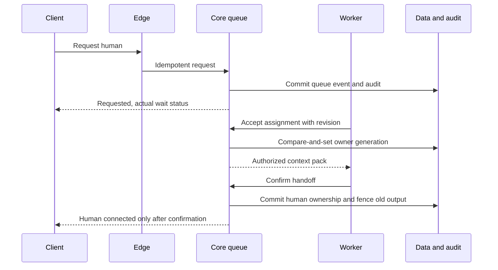

# Actors, interfaces and service workflows

## Role workspaces

One web artifact provides separately routed workspaces; APIs determine access, not route visibility. Separate actor instances use distinct accounts/browser profiles and sessions. Role switch is a fresh scoped session, not a privilege dropdown. Locale defaults EN/FR and America/Toronto display; durable timestamps are UTC. Keyboard navigation, focus, screen reader announcements, contrast and plain language are part of every screen. AI draft, sourced fact, reported assertion, unknown and confirmed outcome have distinct visible labels.

| Workspace / route | Main panels and actions | Authority boundary |
|---|---|---|
| PID `/client` | Disclosure/intake, preferences, plan, sharing, own session, private help, corrections/decline | Own synthetic records and explicit sharing; can refuse optional AI assistance |
| Carer `/carer` | Attributed situation report, permitted plan fields, carer support, service options, consent within authority | Relationship does not grant PID rights |
| Professional participant `/professional` | Attributed observations and participant navigation | Does not grant workforce account scopes |
| Worker `/worker` | Assigned sessions, messages, context pack, missing facts, AI suggestions, editable draft, referral review | Assigned content only; explicit approve/edit/reject; manual messaging always available while dependencies permit |
| Supervisor `/supervisor` | Scoped live observation, queue state, assignment/takeover, aggregate exposure | Explicit case access; no individual exposure/performance metrics |
| Receiver `/receiver` | Own service inbox, permitted fields, accept/reject/partial receipt/clarification | Cannot browse conversation or another recipient’s payload |
| Operator `/operations` | Desired/actual versions, health, kill, rollback proposals, backup status | No standing clinical content/audit read or approval of own change |
| Security `/security` | Denials, evidence digests, quarantine, bounded test scenarios, containment | No default content browsing or autonomous policy relaxation |
| Governance `/governance` | Classified change, artifact digests, evidence/approval receipts, exceptions | Independent scoped approval; missing specialists do not become implementor approval |
| Auditor `/audit` | Read-only authorized audit, coupled aggregates, evidence export | Time/purpose-limited content grant, normally metadata only |
| Trainer `/training` | Fictional scenarios, role-play controls, debrief | Training entitlement independent from live workload access; no clinical certification |

## Intake, assessment and accompaniment

A credentialled participant may have no synthetic PID identity. Edge records disclosure version and role, user-supplied jurisdiction or unknown, language and demo/synthetic tags before assessment. Each turn receives a monotonic index/revision. Synthetic hazard routing executes first and cannot wait for model inference. Assessment fields retain captured/unknown/deferred and source-attributed assertions; closed core `situation_factors` remains empty. Explicit fixtures, never model-extracted clinical factors, determine stub tiers.

Controlled rationale is assembled from structured fixture decisions, approved content and cited observations. Correction, disagreement, decline and alternate pathway are distinct commands and audit actions. Disagreement never disables mandatory human escalation. No diagnosis, prescription, involuntary determination or model-defined legal content is possible through these APIs. Youth/age uncertainty triggers private human-help visibility and conservative role-play routing; guardian disclosure requires separate documented basis.

Session service state: `active → human_requested → queued → assigned → handoff_pending → human_controlled → ended`. Failure may add `degraded` while preserving the prior active state. Transport connected/disconnected and silence are orthogonal states. Only user end or confirmed handoff authorizes closure of unresolved T1+ support. Reconnect resumes the event sequence using an explicit token; account/metadata never silently links personas.

## Human handoff and exclusive ownership

Concurrent accepts use row revision/assignment uniqueness; a losing worker receives conflict. Supervisor takeover increments `conversation_generation`; all queued model messages carry expected generation and fail before delivery if stale. Warm-transfer refusal/drop/timeout preserves active support and records unknown/unconfirmed outcome. Operating states normal/elevated/severe/partner-unavailable/regional-outage use fixture thresholds; partner unknown overrides any inferred wait. Queue priority is deterministic fixture policy, not LLM scoring.

## Planning, service choice and follow-up

PID plan fields retain author, time, verification, disputes and per-recipient sharing. An assistant retrieves only permitted fields and proposes source-linked service options with freshness, catchment, unknown availability and police-involvement qualification where relevant to external-service facts. Project independence is not a guarantee about third parties. Demo directory entries are fictional and never actionable real destinations.

Referral flow: draft→recipient/field preview→authorized grant→exact-payload human approval→execution authorization→attempt→confirmed/partial/rejected/unknown receipt. Service generation is never receipt. A carer’s own support referral is a separate first-class outcome. Follow-up is separately consented, scheduled within 24–72 hours using a controllable demo clock and delivered only to the internal inbox. Cancellation/revocation is checked at dispatch. Plan sharing, export/delete and continuation use operation-specific assurance; see identity design.

Training scenarios use separate population/session namespaces and explicit control of service/clock/hazard fixtures. No participant is asked for a real crisis history. Trainer feedback is a draft until instructor review. A real distress event stops simulation under the participation protocol; the software must not pretend the role-play worker is a contracted real crisis service.

> This prototype demonstrates control and containment architecture using non-clinical stub logic and synthetic data. It provides no evidence of clinical safety, triage validity, or equity performance, and must not be cited as such.
