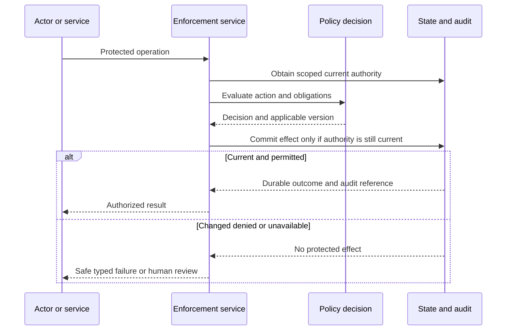

# Safety, security and realtime governance architecture

## Authority and trust boundaries

Security authenticates identities, isolates workloads and protects integrity/confidentiality. Governance determines which approved actions, artifacts and human authorities may be used. They share enforcement infrastructure, but neither a security score nor a governance dashboard grants permission. Clinical/legal/community judgement that is not automatable remains explicitly human-owned; missing approval blocks the affected capability rather than being inferred by a model.

The identity service establishes account/MFA/revocation evidence. Domain services establish participant ownership, assignment, recipient and subject authority. Consent service records explicit purpose/field/recipient grants. Worker/client review supplies scoped human decisions. Policy services evaluate current deterministic rules; application and repository enforcement points prevent the effect. Network/workload controls reduce reachable capabilities independently. Audit records the actual decision and outcome. No layer is replaced by prompt instructions.

## Human authentication and continuation

Private role applications use OIDC/MFA with server-mediated browser sessions; users do not share role credentials. Account identity is separate from synthetic subject identity. Assurance is operation-specific: continuation, plan viewing, editing/referral consent and export/delete/link require progressively stronger evidence according to the requirements. Metadata never increases assurance. A professional participant is not a workforce user, and two accounts for one person do not provide independent approval.

Identity verification must cover trusted issuer/audience/key provenance, signature/time/nonce and login-intent binding, bounded key refresh and ambiguous login outcomes; exact protocol/library settings belong to implementation design. Provider claims alone cannot create assignment, PID consent or local governance roles. On compromised/revoked credentials, current entitlement checks fence new work and active disclosures; certificate/token expiry alone is not prompt revocation.

Explicit one-use continuation is scoped to the participant/session/channel. Operation reconciliation can determine whether rotation committed but cannot recover a lost raw replacement token from a digest. Recovery requires fresh same-principal proof and new explicit authorization, never silent identity linkage or restoration of revoked access. If the identity/proof service is unavailable, static information remains accessible; private content is not disclosed to improve convenience.

## Workload and mesh authentication

The architecture includes a **workload trust plane**, owned operationally by the platform/security function: issuer and workload attestation, trust distribution, credential rotation/revocation, destination verification and compromised-workload containment. Each deployment has a distinct identity bound to its admitted namespace/service account or equivalent host identity. Mutual authentication proves both connection endpoints; no client-supplied identity header or intra-cluster address is sufficient.

The enforcement/data plane authenticates service traffic and applies default-deny caller-to-destination policy. Browser/user identity remains separate and is passed only as verified delegated context. A valid workload credential does not authorize a business resource, purpose, consent or professional action. Repository filters, domain PEPs and fixed absent capabilities remain required even if the mesh is healthy.

**Accepted local direction (DEC-01/B):** standardized service proxies with automated attested workload identity are the initial design candidate. Product/version and feasibility remain unverified, and selection of a materially different family must be recorded explicitly. The alternatives retained for comparison are: a service mesh with automated workload identity/policy distribution, or application/proxy-managed mTLS with an automated issuer and explicit connection policy. Mesh reduces per-service credential handling but adds control-plane/sidecar/host integration complexity; app/proxy mTLS reduces platform footprint but increases integration/rotation responsibility and bypass risk. Validate the accepted proxy-managed approach against attestation, rotation, identity-based deny rules and compromise/outage tests on the actual local cluster, including the approved cost comparison with a full mesh. No product or certificate lifetime is selected by the family approval.

Host inference bridge participates in authenticated trust with the designated inference gateway; host location is not an exemption. Independent help has separate narrowly scoped trust and static publication is content-only/public. During issuer failure, credentials are usable only within current validity and supported revocation/freshness bounds. No new untrusted identities or fail-open connection mode is allowed. Existing connections/queued work from a compromised identity must be fenced; rotation of future credentials alone is insufficient. Cluster/host root and shared trust bootstrap remain residual risks.

## Inline runtime governance

Every protected human, agent, service and scheduled operation has an enforcement point before read, write, disclosure or external effect. A narrow metadata-only authorization-context interface exposes required ownership/assignment/revision facts to authorized PEPs without first disclosing the protected business content being requested. Full content projections are released only after the decision; policy bootstrap is not a privileged transcript-read path. Policy inputs come from authoritative identity/assignment/consent/resource/source/control state. Delegated actions retain both workload identity and originating human/task/purpose with equal-or-narrower scope; a broad core credential cannot convert an agent proposal into worker authority. A proposed action is bound to exact purpose, subject, recipient, fields and reviewed content; materially changed state requires reevaluation. Outcomes are permit, deny or require human; review-required is not execution authority. Unknown inputs, timeout, unsupported obligation or unhealthy audit blocks the affected effect.

Policy ownership, independent approval, signing, activation and enforcement are separate responsibilities. Rule owners define policy within their authority, appropriate independent human reviewers approve material changes, authorized release/control functions sign and activate exact artifacts, and PEPs enforce them. Signing alone proves neither clinical/legal authority nor policy correctness. Policy activation accepts only verified artifacts with independent appropriate human review, class-specific evidence and exact version binding. Staged evaluator readiness precedes relaxation; restrictive changes fence subsequent authorization at the authoritative boundary, while lagging/disconnected enforcement cannot continue with stale permission. Rollback is a new controlled activation retaining newest revocations/consent/deletion restrictions. Events accelerate propagation; execution checks preserve correctness if events are lost/replayed.

Revocation orders against the defined disclosure/dispatch authorization boundary. It blocks future authorization, cancels stale queued work and suppresses later stream events, but cannot recall delivered bytes or guarantee reversal of an already authorized external send. Timing targets distinguish evaluation, propagation, detection and alerting and are not hard realtime guarantees.

## Safe mode and enforcement failure

Kill/safe mode disables affected AI/actions, cancels obsolete output and preserves healthy authorized manual operations. It does not shut down identity, human messaging or static publication indiscriminately. When policy/data/audit is unavailable, normal protected service cannot continue. **DEC-02/A requires fresh authoritative validation for every private minimal-help request, status view and worker acceptance; no cached positive permission or stale-trust grace period is selected.** Its direct host UI/spool remains independent of the main edge, but loss of its sole authority can stop private operations. Independent minimal help can only record/respond to its own narrow opaque requests while current authority and its durable spool are healthy; it has no business history, broad workforce rights or general policy bypass. If trust is stale, private help operations stop and static information remains. A recorded request does not imply a connected or available worker.

## Standards, attacks and accountability

| Concern | Architectural control and failure response |
|---|---|
| Injection or poisoned knowledge | Server-owned labels, approved sources, typed allowlisted tools, quarantine and grounded output review |
| Exfiltration or identity abuse | Workload network/mesh isolation, current object/field/purpose rights, scoped delegation and revocation |
| Untrusted model output | No executable code/policy, controlled authoritative content, human-reviewed professional communications |
| Supply-chain/config drift | Pinned verified artifacts, controlled activation and scope-fenced response |
| Resource exhaustion | Bounded task/compute/work queues with reserved manual/help capacity and scoped throttling |
| Insider or approval forgery | Separation of duties, actual human identity, least privilege and independent audit/checkpoints |
| Audit/authority outage | Deny protected effects with explicit degraded status, not monitoring-only alert |

[Standards baseline](../REQ/09-standards-and-runtime-controls.md) distinguishes OWASP verification, ATLAS threat coverage, governance frameworks and continuous-access architecture. Individual control identifiers, deployed crypto/network behaviour and certification are not established here. Threat tests and human evaluation of language/automation-bias residuals are required; structural validation alone cannot prove safe clinical interaction.

> This prototype demonstrates control and containment architecture using non-clinical stub logic and synthetic data. It provides no evidence of clinical safety, triage validity, or equity performance, and must not be cited as such.
