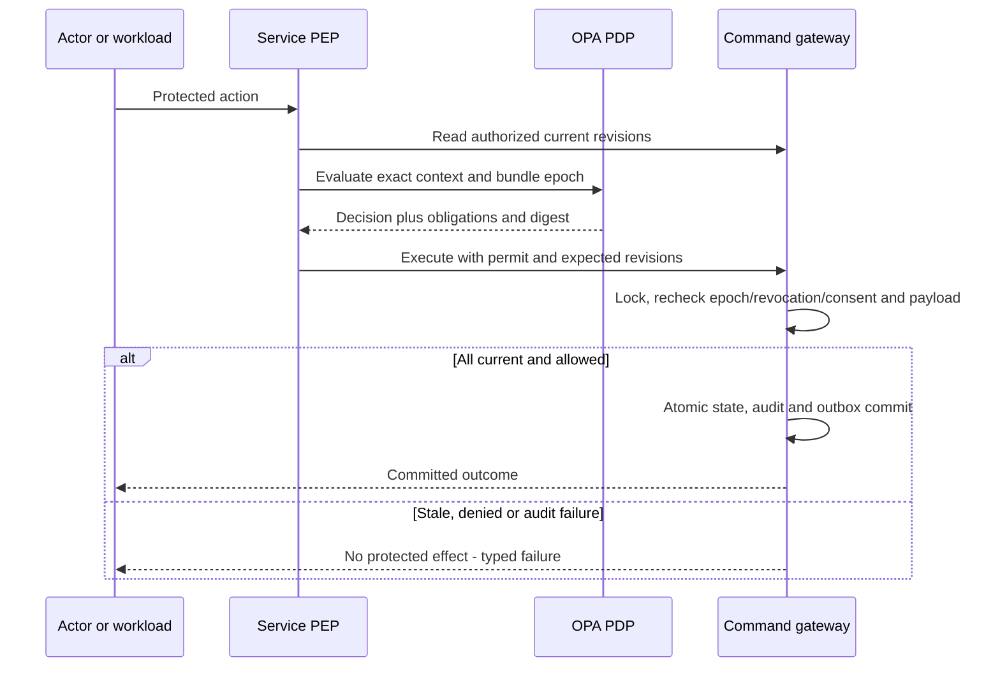

# Safety, realtime security and governance

## Identity and trust

Browser authentication uses Keycloak OIDC authorization-code flow with PKCE mediated by the BFF. Keep tokens server-side; browser receives secure HttpOnly session cookie, CSRF protection and explicit origin policy. Separate role-scoped sessions and MFA are mandatory. Validate issuer, audience, signature, expiry and current revocation/entitlement revision. JWT lifetime alone is insufficient revocation. Public fallback requires no authentication. AL0 continuation is a business-session capability inside this perimeter; AL1 possession proof adds plan view, AL2 reauthentication allows plan edits/referral consent, AL3 step-up plus cooling-off enables export/delete/link. Hash single-use continuation secrets; redeem transactionally within ten minutes and rotate on use.

mTLS workload identities are issued to individual deployments by a local trust bootstrap with short-lived certificate rotation; Kubernetes service-account authorization is separate from certificate identity. Runtime gets only broker scopes. CI can deploy verified artifacts but cannot read business stores or approve its own changes. Database/audit credentials never enter browser, runtime or prompts. Key storage is encrypted host custody plus read-only mounted secret files, with offline recovery material separate from application volumes. Exact certificate issuer/rotation implementation is an admission dependency, not an installed mesh claim.

## Inline authorization and policy state

Every protected operation passes its PEP: edge admission; core broker/service boundary; data repository/command boundary; stream serializer; outbox dispatch; administrative activation. PEP builds authoritative identity, role/assurance, purpose, subject/session, requested fields, consent, assignment, source/artifact revisions, population/environment and governance epoch. OPA decides PERMIT/DENY/REQUIRE_HUMAN with obligations and digest; it cannot execute or approve. Missing/stale data, unknown decision or obligation failure denies effect.

Use a single authoritative policy/control database with monotonic epoch and revocation revisions. OPA evaluates an immutable bundle snapshot; authoritative state passed to evaluation is versioned. The command gateway locks/checks relevant rows including effective epoch before committing effect. A stale evaluator or PEP cannot reuse a prior permit. Positive permits are not cached across actions. Fields are filtered before retrieval/serialization, not after delivery to the model.

Data gateway accepts decision assertions only from authorized PEP identities and independently verifies active digest, exact request binding and revisions; callers cannot manufacture permits. A privileged core/PEP compromise remains a threat, mitigated by narrow endpoint privileges, source-independent hard prohibitions, repository field rules and audit evidence. There is no claim that a signature alone proves semantic correctness.

## Activation, signals and kill

New policy/artifact bundle: proposed→classified→tested→independently approved exact digests→signature verified→staged on evaluators→readiness acknowledgement→activation epoch commit→PEP acknowledgement. Restrictive changes fence immediately at central command commit; lagging evaluators deny. Relaxation waits for required approvals and healthy instances. Rollback is a new epoch selecting an approved compatible bundle; revoked identities/consents remain revoked. Atomicity is per evaluator plus central epoch fencing, not magical simultaneous distributed switching.

Identity events validate issuer/audience/subject, signature, timestamp, five-second skew and sixty-second freshness, unique event ID, deduplication and gap recovery. Adopt SSF/CAEP if provider capability is proven; otherwise use a documented signed local identity-event adapter without claiming CAEP conformance. Custom consent/assignment/policy events use separate types. Notifications trigger cancellation quickly; current-state checks preserve correctness if a message is lost. Critical state is rechecked at every stream delivery/dispatch.

Kill increments authoritative control state, blocks new agent/consequential work, invalidates leases/permits and fences pending model output; does not stop human messaging services, help gateway, identity or static fallback. Human-only core operations remain policy/audit mediated when healthy. A narrow help gateway uses independent durable local spool, fixed credential-verification rules and separate role access; it accepts opaque requests without business content. Existing signed sessions may be validated offline within expiry plus available local denylist; new sign-in is unavailable if IdP is down. Stale workforce assurance permits no sensitive disclosure. If help credentials cannot be trusted, show static information instead of bypassing authentication. A local spool acknowledgement means request recorded, never a connected worker.

## Security controls and residuals

| Threat/control | Enforcement and reaction |
|---|---|
| Injection/poisoned context | Immutable labels, schema/provenance checks, broker tool allowlist, current sourced recipient; quarantine bad record |
| Exfiltration/SSRF | No arbitrary URL tools, pinned gateway host, deny egress/DNS rebinding/redirect destinations, row/field filters |
| Unsafe output | No executable model text; safe encoding/CSP; sourced templates and review; retain human evaluation of language risks |
| Identity/privilege abuse | Current role/assignment/assurance, mTLS identity, replay-resistant signals, stream cancellation and scoped revocation |
| Supply-chain/drift | Pinned images/dependencies/model, SBOM/signature evidence, activation verification, readiness and 30-second drift probe; fence affected workload |
| Resource exhaustion | Input/parser/token/step/concurrency/queue budgets with separate human-help capacity; scoped throttling, not silence-based session termination |
| Insider/audit tampering | Least privilege, no operator content access, dedicated audit writes, hash-chain and separate checkpoints; host root remains residual |
| Governance bypass | Independent digest-bound approval, expiring exception, no self-approval, fixed demo/police/emergency limits |

Decision p95 50 ms, evaluation timeout 200 ms, authorization timeout 1000 ms, permit TTL/propagation 1000 ms are local targets. A transaction that cannot reauthorize in time aborts; no fail-open state. Metrics distinguish enforcement-before-effect from event detection/alerting. No standard prescribes these timings. [Requirements standards baseline](../REQ/09-standards-and-runtime-controls.md) governs OWASP/ATLAS reference pinning, NIST/ISO risk ownership and evidence; no certification is implied.

> This prototype demonstrates control and containment architecture using non-clinical stub logic and synthetic data. It provides no evidence of clinical safety, triage validity, or equity performance, and must not be cited as such.
