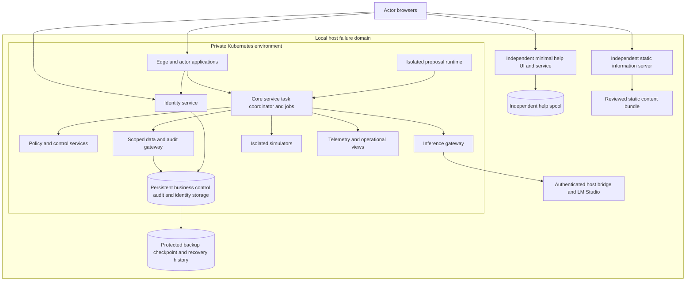

# Deployment topology and technical delivery

## Local deployment model

The selected deployment target is the implementor’s Ottawa host running Docker-built application workloads in a private local Kubernetes environment, with host LM Studio and separately served host help/static functions. This satisfies the requested local demonstration topology while making its shared power, storage, network and administrative failure domains explicit. It does not provide multi-region or whole-host resilience.

This diagram shows placement and principal dependencies, not every authenticated API or monitoring path. The workload trust plane spans protected service connections and the approved host bridge. Administrative backup/recovery access is distinct from business read/write credentials. Separate identity database/credentials may still share a PostgreSQL instance; this isolates privileges, not availability. Minimal help, static content and recovery history must not be merely extra pods or volumes managed by the failed application cluster.

## Isolation and connectivity

Private ingress exposes role applications and identity to authorized project devices. Only public static information may have unauthenticated/public access; private minimal help has its own limited authenticated host entry. Domain endpoints and management surfaces are not public service APIs. Untrusted runtime, core, control, data, simulators and operations have differentiated workload identities, network policies and privileges. Namespace separation alone is not authorization or an independent account/failure domain.

The runtime’s only application destination is the broker; it cannot reach the database, policy engine, host model, simulators, Kubernetes control plane or internet directly. The inference gateway alone reaches the admitted host bridge, which in turn reaches the pinned local model endpoint. No broad host-network exemption or automatic remote model fallback is acceptable. Identity and data services have only their dedicated persistence connections. Necessary name resolution and telemetry are explicitly scoped; network tools cannot silently add arbitrary egress.

Workload attestation, mTLS, destination authorization and credential rotation are platform responsibilities described in document 04. Exact CNI/mesh/issuer choice, VM routing and host trust integration require local proof before deployment. The alternative is not an unauthenticated loopback assumption: host identity and bridge access remain controlled. Compromise of host/cluster root can affect several boundaries and is a residual requiring operational controls and honest evidence limits.

## Technical choices and rationale

React/TypeScript supports distinct accessible role workspaces; Python/FastAPI fits typed domain/service adapters and local inference integration; PostgreSQL provides a consistent initial durable boundary; Keycloak/OIDC separates human authentication; OPA/Rego separates deterministic policy from model content. These are proposed selections from the requirements, not installed versions or irrevocable platform commitments. The core remains modular so boundaries can be strengthened without a service-per-element design.

Docker images, reviewed Kubernetes placement and host service definitions are reproducible release artifacts. Software/model/image versions and resource allocations are pinned only after compatibility, licensing/security and host capacity verification. Adding a mesh, queue or observability product requires a concrete architectural consumer and cost/benefit, not conformity with the abandoned historical stack.

## Release and trust lifecycle

A release binds compatible application, contract, migration, model/prompt/policy, directory/content and configuration versions with evidence and independent human review. Signing establishes provenance, not approval authority or correctness. The proposer, applicable reviewer, signer/activation operator and runtime enforcer are distinct responsibilities even if some infrastructure is shared. Unavailable independent reviewers do not become self-approval through extra accounts.

Build/test and artifact acquisition are maintenance-plane activities, separated from restricted runtime network access. Secrets and key custody are separate from source/images/model prompts/logs. Bootstrap establishes trust and identity before admitting protected service; role credential provisioning is separate from fictional data seeding. Static content publication is independently reviewed and remains usable without runtime registry access.

Maintain last-known-good service while a candidate is verified through realistic role/simulator flows. A failed candidate retains the accepted path; limited single-host resources may require a phased compatible rollout instead of duplicate full stacks. Data/schema compatibility and rollback are reviewed together, not assumed. Rollback is a new controlled activation that preserves current revocations, consent, deletions and serving ownership. Source stubs and fixed scope constraints prevent promotion above demo.

No installation, manifests, database migration, trust-store change, GitHub settings change, commit or deployment is performed by this HLD. Detailed commands/resource sizing belong to explicitly requested implementation work.

> This prototype demonstrates control and containment architecture using non-clinical stub logic and synthetic data. It provides no evidence of clinical safety, triage validity, or equity performance, and must not be cited as such.
