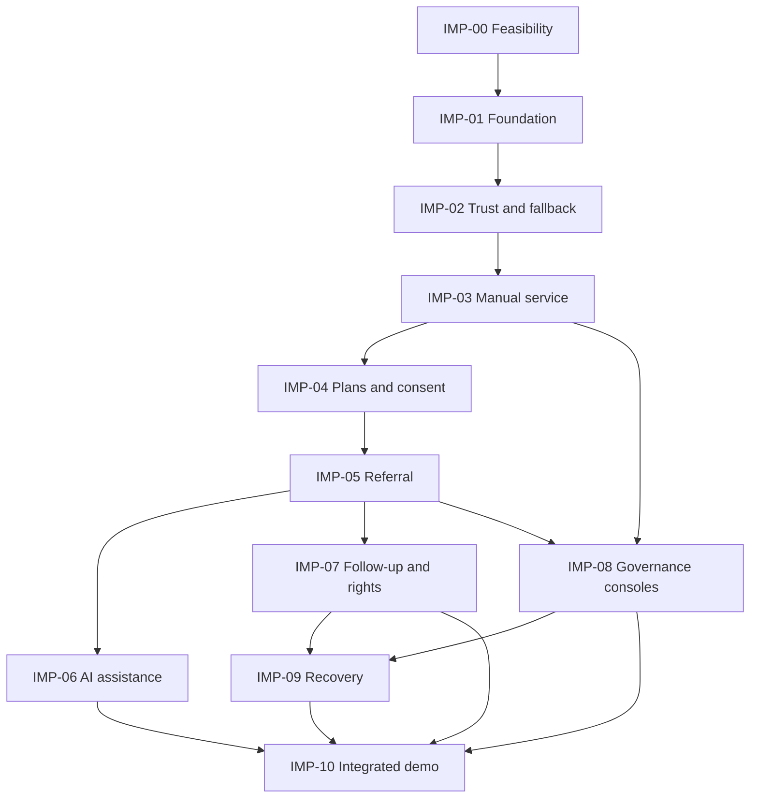

# Staged implementation roadmap

All stages are planned and require the scoped authorization/evidence/human decision defined in this package. The [machine plan](implementation-plan.json) is the canonical dependency/allocation record.

## IMP-00 — Workstation feasibility and implementation decisions

Make an actionable, reviewed environment/tool/model plan without claiming a deployment.

Depends on: none. Human checkpoint: **G-00**.

Scope:

- Read-only workstation inventory when this stage is authorized; redact serial numbers, private account details and unrelated paths.
- Verify available Docker/Kubernetes/CNI/proxy/issuer candidates and current model metadata without automatically starting, loading or downloading a model.
- Propose tested version pins, resource allocation, isolated names/ports and actual-account retention/reviewer arrangements.

Demonstration:

- Show the redacted doctor report and explicit unknowns.
- Show a reproducible decision/pin matrix for uv/Ruff/Python and Node/pnpm/frontend tooling.
- Locate the user-selected google/gemma-4-12b-qat metadata if accessible; distinguish downloaded, loaded and function-admitted.

Adverse outcomes to prove:

- Unavailable listener/model metadata remains unknown; no automatic alternate model or server start.
- Insufficient resources does not increase capacity limits or silently select remote hosting.

Deliverables:

- Redacted workstation inventory
- Reviewed tool/version and installation-action proposal
- Port/volume/namespace allocation
- Model metadata/probe plan
- Account-retention and reviewer decision packet

Verification: VT-01, VT-09, VT-12, VT-17; AT-01, AT-10, AT-11.

Human decision: Accept the concrete tool/version/environment proposal and scoped next-stage setup actions, or request changes. Existing workstation/model choices are not reopened.

Rollback: Read-only stage leaves host state unchanged; discard only generated redacted reports if explicitly requested.

## IMP-01 — Repository foundation and contract walking skeleton

Create a reproducible modular development loop with a visible contract demonstration.

Depends on: IMP-00. Human checkpoint: **G-01**.

Scope:

- Create uv and pnpm workspaces, typed package boundaries, locked dependencies and root command catalog.
- Implement schema adapters/parity tests and isolated API/UI skeleton; no participant admission or fake business success.
- Create CI fast checks and build minimal per-service images for an authorized disposable lab.

Demonstration:

- From a clean checkout run the documented locked setup and checks.
- Open the EN/FR developer shell and show a typed health/capability result.
- Submit an unknown nested key and an overflowing revision; show both Python and TypeScript adapters reject the same inputs.

Adverse outcomes to prove:

- Lockfile/manifest mismatch fails instead of resolving silently.
- A forbidden runtime-to-data import or a schema loosening fails the check.
- Unimplemented operations return explicit capability-unavailable responses rather than synthetic success.

Deliverables:

- Workspace manifests/locks and package exports
- Contract adapter/parity suite
- Minimal role shell and typed capability UI
- CI fast lane and clean-build evidence
- Module dependency test

Verification: VT-01, VT-08, VT-11, VT-17; AT-01, AT-08, AT-09, AT-10, AT-13.

Human decision: Accept the developer demonstration and reproducible command surface; no participant-use or deployment approval is inferred.

Rollback: Revert candidate files/locks together; retain the last verified development baseline and do not touch source repositories.

## IMP-02 — Identity, workload trust and independent help/static paths

Prove private access boundaries and an honest fallback on this workstation.

Depends on: IMP-01. Human checkpoint: **G-02**.

Scope:

- Implement OIDC/BFF/MFA and scoped role sessions; establish attested proxy identity and actual default-deny routes.
- Implement host help/spool with fresh request-bound identity decisions and separate static publication.
- Resolve account-retention scope and current independently reviewed fallback content before participant use.
- Pin the applicable identity/network standard controls and local-control test mapping before accepting those implemented boundaries; full register completion remains IMP-08.

Demonstration:

- Use separate browser profiles for participant and worker identities; direct unauthorized role/API access is denied.
- Create an opaque help request, accept it and show accepted_unconnected.
- Stop the main lab cluster: static survives; if identity is lost, private help becomes unavailable without cached permission.

Adverse outcomes to prove:

- Forged/replayed/expired login or help proof fails.
- Direct backend/DB/model/internet/alternate host-port probes from runtime fail.
- Expired workload credential and compromised open connection cannot retain permission.
- Use a known-active isolated control listener and allowed caller; refusal from an absent server is not credited as denied-route proof.

Deliverables:

- Identity/assurance adapter and credential lifecycle tests
- Proxy/issuer/CNI and host route proof
- Independent help/static processes and publication evidence
- Account metadata schedule/role provisioning evidence

Verification: VT-02, VT-03, VT-12, VT-16; AT-01, AT-02, AT-10, AT-13, AT-15.

Human decision: Review login/help/fallback and denied-route demonstrations. Accept only the observed environment scope; unverified content or trust keeps participant admission disabled.

Rollback: Fence candidate private listeners/identities, retain reviewed static publication, remove only named disposable resources after explicit confirmation of target scope.

## IMP-03 — Usable protected manual client-to-worker service

Deliver the first complete useful actor journey without relying on AI.

Depends on: IMP-02. Human checkpoint: **G-03**.

Scope:

- Implement guarded business/control/audit transactions, current PDP checks, bootstrap signed policy and recovery-journal barrier from the first protected write.
- Implement disclosure, synthetic persona/session, attributed turns, deterministic fixture escalation, queue/assignment and two-party handoff.
- Implement owner fencing, SSE current projections, operation reconciliation and explicit continuation recovery.
- Establish scoped encrypted backup/capture hooks for the first durable state; integrated trusted restore/serving proof remains IMP-09 and unproven protection is visible.

Demonstration:

- Participant enters a fictional case, asks for a human and connects to a worker through current two-party confirmation.
- Worker reads only assigned context and sends a manual message; supervisor takeover changes control epoch.
- Disable AI, then lose a continuation replacement response and recover with fresh same-principal proof.

Adverse outcomes to prove:

- Race two worker accepts and pause old output during takeover: exactly one owner and no stale future output.
- Audit/PDP/journal failure releases no protected success; independent help/static behavior remains truthful.
- Silence/disconnect does not close unresolved support; lost DB acknowledgement reconciles one logical operation.

Deliverables:

- Real PostgreSQL migrations/roles/guarded commands
- Canonical audit and current policy/journal foundations
- Separate actor UIs and manual smoke scenario
- Ownership/continuation/stream race evidence
- Initial backup/capture and restore-to-quarantine harness; no serving-recovery claim yet

Verification: VT-03, VT-04, VT-05, VT-10, VT-11, VT-14, VT-16; AT-02, AT-03, AT-04, AT-09, AT-14.

Human decision: Demonstrate normal manual service and adverse ownership/audit behavior. Human acceptance establishes this bounded baseline, not full-demo or clinical readiness.

Rollback: Keep schema-compatible last-known-good manual path; restrict protected service if current authority cannot be established. Never rewind live rights or erase unresolved cases.

## IMP-04 — Attributed plans, sourced options and granular consent

Support client-led planning and service choice without leaking another actor’s private context.

Depends on: IMP-03. Human checkpoint: **G-04**.

Scope:

- Implement PID/carer attribution, disputes, plan fields/retirement/sharing and current field filtering.
- Implement all seven directory operating states plus source freshness/quarantine/suspension.
- Implement purpose/recipient/field/time/assurance consent and journalled revocation.

Demonstration:

- PID creates and shares selected plan fields; carer sees only those fields and own reports.
- Exercise normal, closure, outage, holiday, weather, API failure and conflicting-source options with truthful alternatives/unknowns.
- Revoke sharing while a stream/task is pending; later disclosure stops and the UI explains missing access.

Adverse outcomes to prove:

- Relationship/professional-participant role does not grant PID/workforce authority.
- An absent-grant concurrent creation/revoke race uses the existing subject guard.
- Expired/stale/conflicting directory information cannot imply availability or a new executable destination.

Deliverables:

- Plan/assertion/consent commands and screens
- Directory provenance/operating-state UI
- Consent/field filtering and revocation race evidence

Verification: VT-04, VT-06, VT-13; AT-03, AT-05, AT-06, AT-07, AT-14.

Human decision: Review exact field-level views and revoke/unknown-state demonstrations using separate accounts; accept the scoped privacy behavior.

Rollback: Disable affected plan/share/option capability if filtering fails; retain current negative rights and the accepted manual service.

## IMP-05 — Reviewed simulated referral and receiver reconciliation

Complete client→worker→receiving-service work with exact consent and honest delivery states.

Depends on: IMP-04. Human checkpoint: **G-05**.

Scope:

- Implement manual unsent drafts, exact payload review, immutable generations and current dispatch authorization.
- Implement stable dispatch IDs, consumed authorization, outbox attempts/receipts and receiver-owned decisions.
- Add receiver inbox and bounded scenario controls; no real contacts or external connectors.

Demonstration:

- Client supplies exact consent; worker reviews fields/purpose/recipient/digest and sends to isolated receiver.
- Receiver partially accepts or refuses; worker sees the actual receipt and keeps client support active.
- Drop the response after receiver storage; reconcile by dispatch ID with no duplicate package.

Adverse outcomes to prove:

- Revoke/change policy/assignment/source between PDP evaluation and final authorization: stale send is absent.
- Timeout, generic receipt unavailable and partial result never become accepted/connected by inference.
- Changed payload under an existing key is rejected; machine emergency/police target remains absent/denied.

Deliverables:

- Referral/dispatch and receiver modules/UIs
- Deterministic receiver failure scenarios
- Consent-review-dispatch race/crash suite and evidence

Verification: VT-06, VT-07, VT-11, VT-12; AT-05, AT-08, AT-09, AT-14, AT-15.

Human decision: Demonstrate exact review, before/after-authorization revocation and dropped-reply reconciliation. Human acceptance concerns simulator behavior only.

Rollback: Fence unsent work; retain unknown in-flight attempts for reconciliation. Roll back only compatible code, never rewrite receipt/consent history.

## IMP-06 — Useful bounded AI assistance on the selected local model

Add optional source-linked assistance to an already usable manual workflow.

Depends on: IMP-05. Human checkpoint: **G-06**.

Scope:

- Implement task profiles/bindings, shared counters, step leases/fences, typed tools, server-built context and human draft review.
- Integrate broker→gateway→host bridge→LM Studio google/gemma-4-12b-qat with verified identity/token accounting and function-specific admission.
- Keep timeout/cancel compute slots occupied until completion/stop is actually established; preserve manual capacity.
- Verify pinned applicable OWASP/ATLAS identifiers and per-function threat/test mapping before affected AI function admission; do not defer this to the final console stage.

Demonstration:

- Compare the same fictional case actor-only versus assisted; show retrieved sources, draft edits/rejection, bounded observations and receipt follow-through.
- Reject every suggestion and complete the manual workflow.
- Timeout generation while compute continues: stale output is fenced and manual service continues.

Adverse outcomes to prove:

- Prompt/tool/source injection cannot create authority, arbitrary network access or direct runtime inference.
- Lease reclaim/restart does not reset step/tool/proposal budgets.
- Changed sources/payload/epoch invalidate review; unsupported function stays disabled without swapping model.

Deliverables:

- Coordinator/broker/runtime modules and tool profiles
- Fixed local inference adapter and model manifest
- Per-function grounding/EN-FR/adversarial/latency evidence
- Actor-only/assisted evaluation and rollback/disable controls

Verification: VT-08, VT-09, VT-18; AT-08, AT-17, AT-18.

Human decision: Review actual source-linked usefulness, seeded errors and outage behavior. Admit only demonstrated functions; record unadmitted functions as explicit remaining scope.

Rollback: Disable AI functions/prompt/model bundle under current control epoch; preserve manual service, current rights and independently available fallback.

## IMP-07 — Post-crisis inbox, lifecycle, exports and deletion

Close the supported synthetic workflow with truthful follow-up and rights processing.

Depends on: IMP-05. Human checkpoint: **G-07**.

Scope:

- Implement explicit post-crisis anchor/pending state, separate contact consent, internal inbox, cancellation and attributed outcomes.
- Implement copy inventory/anchors/dependencies/holds, guarded purge, current-authorized export and faster verified deletion targets.
- Keep backup-dependent completion pending until recovery/expiry evidence in IMP-09; no false physical-erasure claim.

Demonstration:

- Schedule a follow-up within the explicit 24–72h anchor window, then opt out before authorization and show no inbox delivery.
- Show an active plan surviving session expiry under its own purpose, and a held dependent copy with an explicit exception.
- Export only own permitted reports; delete eligible active content while backup status remains accurately pending.

Adverse outcomes to prove:

- Missing anchor/cyclic dependency/hold blocks unsafe purge; two tabs cannot bypass AL3 cooling and fresh proof.
- Unknown inbox send requires durable absence plus old-sender fencing before reauthorization.
- Carer own-data rights do not export/delete PID or other-author private content.

Deliverables:

- Follow-up/inbox/outcome screens and jobs
- Lifecycle/hold/tombstone/export/delete modules
- Rights/copy graph/race evidence and pending-backup reporting

Verification: VT-06, VT-11, VT-13, VT-14; AT-06, AT-09, AT-11, AT-14.

Human decision: Review cancellation, own-data export, active purge and retained-exception demos. Accept only the proven active-copy scope; backup erasure remains a later obligation.

Rollback: Stop purge/delivery jobs and preserve restrictions/holds. Never restore deleted content to simplify rollback; use quarantined recovery if necessary.

## IMP-08 — Operational governance, security and accountable evidence consoles

Expose and verify controlled live change, scoped containment and honest operational evidence.

Depends on: IMP-03, IMP-05. Human checkpoint: **G-08**.

Scope:

- Complete class-specific artifact/reviewer registry, signed activation/ACK/rollback, exceptions and incident controls on top of IMP-03 enforcement.
- Implement operator/security/governance/auditor workspaces, current scoped evidence and coupled suppressed aggregate reports.
- Add drift/resource/identity response drills; pin exact applicable standards identifiers from official artifacts.

Demonstration:

- Propose a changed policy/artifact, show missing reviews, then activate exact approved bytes and current per-boot ACKs.
- Introduce a restrictive update while an operation is paused and show the old permit cannot execute.
- Show bounded containment, desired/current epochs, coupled metrics and no individual exposure export.

Adverse outcomes to prove:

- Two accounts for one human cannot self-approve; expired exception/old ACK/rollback cannot restore rights.
- Missing audit/current state denies effects; telemetry or a classifier never grants permission.
- Small cohort/differencing and isolated police-avoidance export are denied/suppressed.

Deliverables:

- Control/incident/evidence consoles
- Live activation/ACK/rollback and drift tests
- Pinned standards/control evidence map and aggregate disclosure tests

Verification: VT-02, VT-10, VT-12, VT-18; AT-12, AT-14, AT-15, AT-16.

Human decision: Review live restrictive/relaxing change, independent approval separation and containment/metrics demos; accept only the observed authorities and environment.

Rollback: Use a new controlled epoch selecting a compatible previous bundle; retain newest revokes/deletes/holds and independent serving ownership.

## IMP-09 — Backup, current-authority restore and serving promotion

Prove that old snapshots cannot resurrect revoked rights and that cutover cannot create two serving generations.

Depends on: IMP-07, IMP-08. Human checkpoint: **G-09**.

Scope:

- Implement encrypted backup inventory/checkpoints, immutable expiry and isolated restore targets.
- Reconcile live host journal/rights/holds/unknown sends, seal target evidence and obtain distinct human serving approval.
- Test maintenance/old-generation fence/router/target enable/smoke interruptions and measure full RPO/RTO.

Demonstration:

- Restore an old snapshot containing revoked/deleted/shared data into quarantine; verify current restrictions before any serving.
- Change the current head after approval; show promotion is rejected until revalidated/reviewed.
- Crash during cutover and show both generations remain restricted until one current generation is established.

Adverse outcomes to prove:

- Missing/corrupt/suspect head cannot be replaced by an old signature/time/sequence.
- No stale continuation/bearer/lease/review/dispatch authorization becomes active on restore.
- Restoring a backup does not renew expiry; uncertain send reconciliation creates no duplicate effect.

Deliverables:

- Backup/restore/generation gate tooling and runbooks
- Separate approver evidence bound to exact target/head
- Crash matrix, deletion/retention restore proof and measured RPO/RTO

Verification: VT-07, VT-13, VT-14, VT-15, VT-17; AT-09, AT-10, AT-11, AT-14, AT-15.

Human decision: Review stale-head and interrupted-cutover demonstrations. A drill acceptance is not approval of future restores; each actual serving promotion retains its own exact human decision.

Rollback: Keep protected serving quarantined. Reconcile gate/router/DB under restriction and use a newly validated compatible target, never blind rewind.

## IMP-10 — Integrated demonstrator acceptance and sustainable delivery

Present a complete bounded demonstrator with reproducible evidence and remaining limitations.

Depends on: IMP-06, IMP-07, IMP-08, IMP-09. Human checkpoint: **G-10**.

Scope:

- Run all actor journeys/use cases, applicable invariant/adverse suites, EN/FR accessibility and internal channel/training scenarios.
- Measure declared workstation load, failures/cold-warm model behavior and actor-only/assisted outcomes with raw missingness.
- Reconcile every local/source requirement disposition, reproducibility, LKG, runbooks and independent human review.

Demonstration:

- Run the full client→worker→receiver→plan/follow-up/rights journey across separate profiles and show real observations.
- Disable model/policy/audit/identity/cluster in turn and show only capabilities whose dependencies survive.
- Have the human follow the published demo/runbook from a clean candidate with exact artifact/source/config pins.

Adverse outcomes to prove:

- No critical authorization bypass, false connection/outcome or concealed unmet obligation is acceptable.
- Real channels/partners/clinical capability/production readiness remain excluded or deferred explicitly.
- A changed candidate or environment invalidates stale acceptance.

Deliverables:

- Reproducible demo/runbooks and evidence index
- Full requirement/control/source disposition matrix
- Workstation performance and actor-evaluation results
- Human acceptance/candidate release record and compatible rollback

Verification: VT-01, VT-02, VT-03, VT-04, VT-05, VT-06, VT-07, VT-08, VT-09, VT-10, VT-11, VT-12, VT-13, VT-14, VT-15, VT-16, VT-17, VT-18; AT-01, AT-02, AT-03, AT-04, AT-05, AT-06, AT-07, AT-08, AT-09, AT-10, AT-11, AT-12, AT-13, AT-14, AT-15, AT-16, AT-17, AT-18.

Human decision: Accept the exact synthetic-demo candidate, request rework or accept a clearly narrowed scope with recorded remaining obligations. Never infer production/clinical approval.

Rollback: Retain last verified accepted candidate if current and compatible; otherwise restrict private service and retain independent static information. Preserve all current rights.
