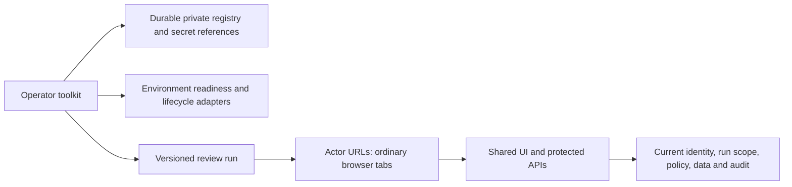

# Review and proposed design

## Required outcome

A reviewer starts a named scenario from scratch, signs into participant, worker1, worker2 and supervisor in ordinary tabs of the same browser/profile, completes the visible journey, then starts another fresh run without clearing cookies/cache or remembering technical recovery steps. Reload, reauthentication and interrupted requests recover from current server authority. Previous runs remain preserved and distinguishable.

“Profile/cache independent” means browser history and cached UI state never determine actor, assignment, permissions, scenario progress or retry identity. Authentication still uses secure cookies. A new profile may require sign-in; an existing profile must work equally well. The proposal assumes different actor hostnames are acceptable within one browser; identical-origin multi-actor tabs would require a different authentication design.

## Findings from current source

| Finding                                     | Mechanism and consequence                                                                                                                                                                                                                                   | Evidence                                                                                                                                                                                                                                                                               |
| ------------------------------------------- | ----------------------------------------------------------------------------------------------------------------------------------------------------------------------------------------------------------------------------------------------------------- | -------------------------------------------------------------------------------------------------------------------------------------------------------------------------------------------------------------------------------------------------------------------------------------- |
| Cross-role tabs share login                 | One host-wide session cookie is used; successful login replaces the captured predecessor. Another role tab can change the authenticated identity seen by existing tabs. Separate ports do not isolate cookies.                                              | [identity cookies](../../../../../../services/identity/src/care_link_identity/app.py), [login replacement](../../../../../../services/identity/src/care_link_identity/service.py), [core cookie authentication](../../../../../../services/core/src/care_link_core/manual_security.py) |
| Login ceremonies can interfere              | Anonymous CSRF bootstrap changes a shared browser-binding cookie; overlapping starts on one host can invalidate another callback's binding.                                                                                                                 | [identity app](../../../../../../services/identity/src/care_link_identity/app.py), [login intent checks](../../../../../../services/identity/src/care_link_identity/service.py)                                                                                                        |
| Same-login streams can displace each other  | Channel key is account plus browser-session digest, without conversation/tab. Each new stream advances generation; older streams become invalid. Native reconnects can repeatedly replace one another.                                                      | [channel registry](../../../../../../services/core/src/care_link_core/manual_channels.py), [event stream](../../../../../../services/core/src/care_link_core/manual_app.py)                                                                                                            |
| Assignment controls are not reconstructible | Accepted assignment exists only in local component state, cleared on identity loss/reload. Queue refresh does not recover its exact revision.                                                                                                               | [worker UI](../../../../../../apps/web/src/manual/Workforce.tsx), [confirmed investigation](../003-live-qualification/evidence/continuation/worker-open-001/review.md)                                                                                                                 |
| Session displays can disagree               | Main account and manual support use separate identity hooks and checks; the page also contains an independent preview-role selector. Authentication, preview and service state appear together.                                                             | [application](../../../../../../apps/web/src/App.tsx), [account hook](../../../../../../apps/web/src/trust/channel.ts), [manual hook](../../../../../../apps/web/src/manual/useManual.ts)                                                                                              |
| Recovery is confined to mounted memory      | Draft, pending command/last ACK and one-time challenge state are held in React memory. Full navigation/reload cannot reconstruct them through the existing UI.                                                                                              | [manual workspace](../../../../../../apps/web/src/manual/ManualService.tsx), [command lifecycle](../../../../../../apps/web/src/manual/useManual.ts), [confirmation UI](../../../../../../apps/web/src/manual/Connection.tsx)                                                          |
| Test isolation differs from requested use   | Extended tests create separate browser contexts per actor; those contexts intentionally isolate cookies. The newest visible worker test ends at participant-confirm visibility. The unit fixture also sets owner on acceptance before the real server does. | [fresh worker test](../../../../../../tests/e2e/imp03-extended/handoff-ui.spec.ts), [UI fixture](../../../../../../apps/web/src/manual/ManualService.test.tsx)                                                                                                                         |
| Operator lifecycle is session-specific      | Profiles select scope at import and default to original; fixed names, temporary private roots, fresh-only provisioning and bounded trust maintenance do not provide a durable run manager.                                                                  | [profiles](../../../../../../tools/imp03_shared/profiles.py), [model](../../../../../../tools/imp03_shared/model.py), [trust maintenance](../../../../../../tools/imp03_shared/trust_refresh.py)                                                                                       |

These are source-confirmed mechanisms. Cross-tab interference and reconnect oscillation need deterministic reproduction; they are not proved causes of every historical symptom. Browser cache corruption is not established: current fetches and protected responses already use `no-store`. Do not prescribe cache clearing as a repair.

## 1. Actor slots in one browser

Give each run four explicit actor-slot HTTPS hosts, for example `r123-participant.qualification.localhost`, `r123-worker1.qualification.localhost`, `r123-worker2.qualification.localhost` and `r123-supervisor.qualification.localhost`. These are illustrative, unissued hosts. They serve the same application distribution and existing protected service boundary. A new run gets new host identities; another full infrastructure stack is not the default.

Host-only `__Host-` session and binding cookies isolate slots. Different ports, paths, role dropdowns, localStorage tokens and private/incognito profiles are not substitutes. An origin label is a workspace address, never permission or proof of identity.

A trusted server registry maps exact host → environment/run/slot → expected application account/provider subject, permitted role and callback configuration. Reject unknown hosts and untrusted forwarded-host values. Bind login intent, state, nonce, PKCE, redirect URI, browser binding, resulting session and CSRF validation to that registered context. The current single-origin identity service needs deliberate multi-origin composition; adding DNS aliases alone is insufficient.

The provider's own SSO cookie remains shared. Review sign-in must deliberately request fresh/account-selecting authentication using supported OIDC behavior, then verify the actual issued subject/account/role against the slot before displaying private content. A role match alone cannot distinguish worker1 from worker2. Retain MFA/assurance requirements and existing verification. Concurrent login attempts on the same slot must preserve an established binding or explicitly reject/supersede one ceremony; callback arrival order cannot silently choose an actor.

Slot sign-out revokes that exact app session and its applicable provider credential. It must not invoke browser-wide provider logout implicitly. Test actual provider revocation effects; if revocation affects siblings, give slots separate provider clients/token grants before claiming logout isolation. A wrong-account callback leaves the slot unconnected with an actionable explanation.

DNS, certificate SANs, exact provider callback registration and server-origin allowlists evolve as one environment configuration. Human browser certificate trust must be established through an explicitly approved environment setup and verified in a fresh profile. Warning bypass and per-review cache/profile preparation cannot satisfy the criterion. This plan does not install roots, edit DNS or register redirects.

## 2. One authoritative, recoverable actor workspace

Use one main-origin session provider for the account panel and manual workspace; keep the independently hosted help surface independent. Bootstrap automatically from the server on entry/focus/reauthentication. Normal review should not require separate “Check account”, “Check manual access” and manual UUID re-entry steps.

| UI state                               | Required behavior                                                                                      |
| -------------------------------------- | ------------------------------------------------------------------------------------------------------ |
| Checking                               | Show the run/slot label and bounded progress; do not show cached private projections                   |
| Signed out / reauthentication required | Offer sign-in for the expected slot, preserving server-held work                                       |
| Ready                                  | Show verified actor, conversation, assignment, truthful connection state and the next permitted action |
| Reconnecting / service unavailable     | Keep stable workspace chrome and recovery action visible; hide unauthorized/stale private fields       |
| Forbidden / wrong actor                | Explain access loss or mismatch; never silently reuse another actor's workspace                        |
| Operation outcome unknown              | Show the original operation and reconcile/retry it; do not create a replacement send                   |

Separate identity, resource loading, channel status and operation outcome in the model. An SSE error must not erase the navigation/recovery controls. Loaded private data remains subject to current authorization and publication-generation checks; retaining workspace chrome does not retain permission.

Proposed server-authorized workspace projection supplies current context, accessible conversation references, exact own assignment state/revision, current control epoch, handshake summary and unresolved operation references. Reload fetches this projection. Non-secret run/conversation routing IDs can be in the URL; authentication tokens, provider credentials, drafts and permission decisions cannot. Keep advanced contract previews and operator diagnostics outside normal actor flows.

Server-held encrypted drafts are scoped to run, exact principal, conversation and draft revision, with expiry and explicit discard. They remain separate from submitted messages. Same-principal reauthentication can recover them; another principal cannot. A submission intent binds a server-issued operation ID to a draft revision/action before dispatch. Intent creation/retrieval must itself be idempotent for that revision/action so losing its response cannot create two sends. A fresh page retrieves the pending intent and canonical outcome; committed actions are not resent. Define retention/migration and race semantics before implementation.

One authoritative interactive channel lease per run/slot/login is the initial policy. A duplicate tab opens as an observer with no competing authoritative channel and offers explicit “Use this tab”. Taking control fences the previous lease/ACK generation; it does not change business ownership. Different roles have independent leases. Different conversations under one slot must not silently compete. Reconnect uses bounded backoff and current authority; it cannot produce two autonomous takeover loops.

Cookies alone cannot distinguish those tabs. The server issues a per-view lease handle, bound to the authenticated principal/session, run/slot and current lease generation. Every interactive business write, including draft changes and channel ACKs, supplies that handle; stale/observer handles are rejected at final authorization. Explicit lease acquisition, authentication and permitted status recovery use their separately checked paths. The handle lives only in page memory and supplements current identity/CSRF/PDP checks; it is not a reusable login credential. The active stream also binds its handle, using a fetch-based SSE transport with a request header rather than putting a credential in a URL. Observer tabs use authorized snapshot polling without opening an authoritative channel. Reload recovers server-held work, then explicitly reacquires the interactive lease; it cannot inherit control from a copied URL. P0/P3 must settle and test the precise transport/lease contract.

Handshake recovery uses an authorized read-only status projection without disclosing/reusing consumed nonces. Show who still needs to confirm and the expiry. Start preparation when both actor windows are ready; on expiry/reload/lease replacement offer explicit fresh preparation. Keep the existing 30-second limit until separately reviewed; never synthesize a participant ACK or mark a human connection from mere stream presence.

## 3. Reference toolkit: environment, run and attempt

An **environment** owns the existing services, deployment binding, trust and custody. A **run** owns scenario version, actor-slot bindings, fresh business resources and review progress. An **attempt** owns a stable command identity, preconditions and result. A new run means fresh scenario state; resuming continues the exact existing run. Neither operation rewinds rights, resets a fence, clears browser data or silently adopts unknown resources.

For the first implementation, support one active review run per explicitly leased environment, with multiple actor slots. Store run membership for newly created conversations atomically through the data gateway. Derive run context from the registered origin/session, include it in signed delegation/current authorization, and scope queue/workspace/resource queries to it. An operator registry alone cannot isolate today's global queue. Run closure moves through active → closing → closed and invalidates business admission at final authorization, while preserving unresolved conversations/audit. Closing reconciles in-flight operations through the gateway. After closure, an exact same-principal reauthentication may obtain only status-recovery access for that run: authorized canonical operation-status reads remain possible, while sends, retries with side effects, new workspace business actions and implicit reopening deny. This recovery remains subject to environmental fences, current identity and policy; it never overrides an emergency restriction. Neither an operator database query nor a new run may substitute for this product recovery path. Closed-run login/authorization purpose and status-only scope must be explicit in P2 contracts. Do not build general multi-tenant hosting or duplicate the 27-container target for every repetition.

Persist a versioned owner-only registry in a durable user-state directory outside the repo and temporary roots, e.g. `~/Library/Application Support/CARE-Link Demo/` on this workstation. Keep secrets in the OS credential store, with references/revisions in the registry; support an encrypted vault adapter where unavailable. Runtime configuration under temporary directories is derived material and can be recreated from authorized durable state. Missing durable secrets must produce a precise recovery requirement, not silently regenerated identities.

Persist environment IDs and ownership receipts, run/slot/account bindings, scenario/core/toolkit versions, resource membership, lifecycle state, operation IDs and redacted results. Secret contents, raw OIDC URLs, session cookies, TOTP seeds and admin DSNs stay out of Git, browser URLs, process arguments, logs and public evidence. Reusable synthetic actor identities may be environment-scoped; their sessions and slot grants are run-scoped. Credential rotation is explicit, resumable and verified before old references are retired.

| Proposed interface (not implemented)                          | Semantics                                                                                                                                                        |
| ------------------------------------------------------------- | ---------------------------------------------------------------------------------------------------------------------------------------------------------------- |
| `environment inspect`, `doctor`                               | Read ownership/version/readiness, DNS/TLS, issued actors, SVID/bundle lifecycle, fences and dependencies; distinguish process presence from usable actor paths   |
| `run create --scenario manual-service --environment <id>`     | Persist creation intent; create a fresh run and empty scenario namespace through authorized adapters; do not acknowledge disclosures or simulate human decisions |
| `run inspect`, `run resume`                                   | Recover the exact run and partial operations; reject ambiguous ownership/version mismatch                                                                        |
| `actors list`, `run open --actor <slot>`                      | Display verified non-secret actor metadata and open a credential-free actor URL                                                                                  |
| `credentials reveal`, `credentials otp`, `credentials rotate` | Explicit local retrieval/rotation for a named synthetic actor; no implicit plaintext exports or seed display                                                     |
| `run close`                                                   | Close business admission/revoke business sessions; preserve support/audit and same-principal status-only reconciliation                                          |

`environment register --manifest <path>` records an explicitly identified, already-owned environment in the local durable registry after verifying its non-secret ownership receipts; it grants no ownership and performs no provisioning. Secret import is a separate explicit local credential-store action. P1 implements these local metadata/custody paths before any run mutation.

Commands require explicit environment/run IDs; no destructive default to the original profile. Mutations record durable intent before side effects, use per-environment locking and exact ownership receipts, and inspect partial failures before resume. Provider/admin adapters configure authorized synthetic bindings; they do not bypass the product gateway to perform actor business actions. Purge and broad teardown are outside the initial toolkit.

Reuse existing provider verification, private-write/custody checks, scoped provisioning and trust/mesh primitives behind typed adapters. Retire fixed chat paths and import-time scope selection from the public toolkit interface. Preserve initial-only refusal guards. Move public bundle renewal/readiness into an environment-owned supervised lifecycle with recorded status; a chat's finite watcher must not be the ongoing availability mechanism. Never restart consumed-token SPIRE agents indiscriminately.

## 4. Evolution and explicit design deltas

Version toolkit registry, scenarios, core capabilities/contracts and migrations together. Each core behavior change updates the scenario adapter, diagnostic, positive/adverse checks and concise run receipt in the same change. Reject unsupported combinations before mutation; provide explicit migration plans. Keep one current result/index per run and append command records privately instead of copying entire qualification packets on every correction.

The new origin-context/run binding, authoritative workspace/assignment projection, draft/submission intent and channel lease/status semantics require coordinated contract/data/policy changes. These are proposed deltas, not implemented controls or amendments to accepted documents. Preserve current identity, MFA, CSRF, signed delegation, PDP, gateway transactions, audit/journal and fencing. Any incompatibility with retained requirements must be reconciled before affected implementation.

Proposed code homes: existing `apps/web/src/manual` and `trust` for actor UX; identity/core/data for their owned contracts; `tools/demo` for the durable reference CLI/adapters; `config/demo/scenarios` for versioned non-secret scenario definitions; existing cross-component test areas for verification. These directories are proposals only; none is created by this design task.

## Technical references

Cookie host scope and `__Host-` requirements follow [MDN Set-Cookie](https://developer.mozilla.org/en-US/docs/Web/HTTP/Reference/Headers/Set-Cookie). Provider login/state/nonce/redirect behavior follows [OpenID Connect Core](https://openid.net/specs/openid-connect-core-1_0.html). The required shared-cookie browser test uses multiple pages of [one Playwright browser context](https://playwright.dev/docs/pages); separate contexts remain useful for other isolation tests but do not demonstrate this requirement.
