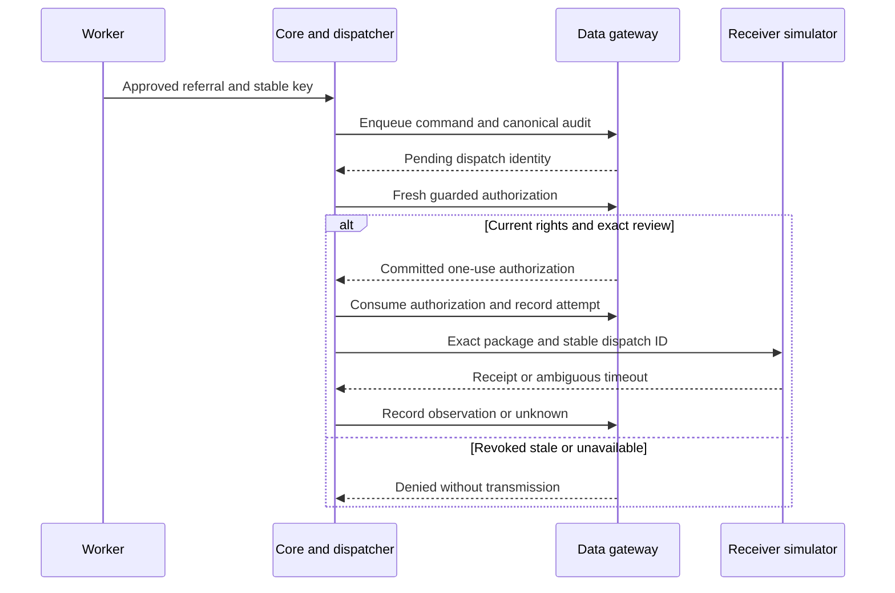

# Plans, consent, sourced directory and referral effects

## Plan and assertion service

Plan create/edit/view require own PID scope or exact authorized shared fields and operation assurance (AL1 view, AL2 edit). A carer can append own attributed report but cannot overwrite PID-authored wishes. Plan field keys are closed; each version preserves value, author, effective time, source, verification and dispute. Corrections append and advance plan/subject revisions. Safety-relevant conflicts create human-review work; no model resolves them silently. Active plan snapshots have independent justified plan purpose and lifecycle; ordinary plan cleanup starts at explicit retirement, not session age.

Sharing is a consent grant with purpose plan, exact account recipient, field set and explicit expiry. Every plan read and event projection resolves current sharing. Revoke is a journalled restriction, increments subject authority and invalidates future projections/tasks. Prior disclosed bytes cannot be recalled. Self/delegation authority is independently provisioned and proven; a text relationship or model assertion is never a grantor proof.

## Consent computation

Canonical scope digest covers version, subject, authorized grantor reference, session, purpose, recipient kind/ID, sorted unique field set, basis, effective/expiry and source revisions. For self consent the client obtains authority_proof_id from a verified StepUp ceremony bound to exact subject and referral_consent/plan purpose; SessionView supplies its authorized own subject ID. The server resolves that ceremony and current own-subject binding, never trusts an arbitrary ID. Delegated proof is a separately provisioned explicit demo delegation, not a carer relationship. ConsentService validates current grantor proof, AL2 for referral consent, supplied subject/session ACL, allowed fields and now interval. Referral grants expire within 15 minutes; explicit plan/follow-up expiry follows reviewed scope. No null/wildcard recipient, purpose, field set or implicit continuing consent. Append grant event and current projection atomically under subject/session guard and audit; guard protects absence as well as existing grant rows.

`valid_consent(action)` is true only if subject/session/purpose/recipient all match, requested fields⊆grant fields, basis/proof remains valid, now≥effective_at and now<expires_at, no revoke/deletion restriction, and dependent authority revisions are current. General actor/assignment permission AND consent are required. Separate contact consent never inherits referral consent. Positive decision cache is zero. Revocation/expiry is checked at final dispatch and output boundaries, not only by expiry jobs. Append-only history supports minimized dependent negative-rights evidence after ordinary content expires.

## Directory and knowledge

Directory records hold fictional service ID/version, catchment/jurisdiction, hours/exclusions, age/language eligibility, capacity state, police involvement qualifications, alternative and per-field provenance. Source ID/revision/verified time/freshness/owner/method/digest are recorded; conflicting facts stay disputed, not merged into certainty. New feeds undergo shape/size/tag/digest/signature and source authority checks; invalid/poisoned/unverified records quarantine without replacing last admitted version. Never fetch submitted URLs, follow redirects or execute feed instructions.

Freshness per field: structural720h, operational24h, near-realtime300s; event-specific facts revalidate before action. Stale values become unknown_with_warning and cannot satisfy required eligibility/capacity. Critical suspension has a60-second target, but authoritative suspension at service_guard immediately blocks subsequent local dispatch authorization. Service listings state third-party police involvement/unknown qualifications honestly; CARE-Link has no police actor/connector. Qualification is information, not a routable police destination. Option choice includes a named reviewed alternative or explicit absence. No inferred wait/availability/ETA.

Executable destination mapping is separately signed technical config `service_id→isolated simulator identity/path`. Directory/user/model content contains no executable URL/address. Only admitted service IDs with matching current source version resolve. DNS is pinned to internal service identity; reject redirects, arbitrary addresses, host aliases and unsupported address families. Knowledge protocol/template claims require exact approved artifact/section/locale applicability and cannot be replaced by generated assertions.

## Referral generation and review

Create draft selects source assertion/plan-field versions, exact service+directory revision, purpose and fields. Data gateway projects only authorized fields and builds immutable canonical payload; hash it after canonical JSON serialization. UI displays all values, provenance/conflicts/unknowns, recipient/qualifications, purpose, expiry, digest and intended effect. Consent and worker approval are distinct. A human-edited draft creates a new generation/digest, stales old review and requires matching consent scope. Directory/subject/assignment/policy/source changes invalidate review where material; final handler compares the full version vector conservatively and requests refresh on any change.

Review accepts exact draft/payload/source vector/recipient/fields and expires≤300seconds. Role authorization/consent is still checked independently. Machine review cannot fill professional acceptance. A review of text is not clinical accuracy evidence. Store AI/human provenance and final author. Agents can prepare drafts/check receipts, never grant consent or dispatch an emergency target.

## Dispatch algorithm and uncertain results

1. A human-approved dispatch request stores one logical dispatch ID for referral generation with payload digest, scope, consent/review references and outbox intent in the same guarded audit transaction. `pending` is not authorized transmission.
2. Dispatcher leases work with monotonic fence. Immediately before send it re-enters final authorization: current caller/owner, policy/kill/serving generation, consent/review interval and exact payload, directory guard, restriction barrier and budget. Commit one-use authorization, attempt record, canonical decision and `authorized` state. This commit is the irreversible local authorization boundary. No DB lock is held across network I/O.
3. Consume authorization once by CAS and write `attempted` before sending fixed simulator request with dispatch ID+digest. Crash after consumption/before bytes means uncertain, not safe fresh authorization. Lease reclamation inspects authorization/attempt and queries receiver by stable dispatch ID before any repeat.
4. Receiver validates workload, service mapping, schema/tags and digest; stores `(recipient,dispatch_id,digest)` plus package before returning observed receipt. Same key/digest returns current authorized receipt; different digest rejects/quarantines. Receiver actor accepts/rejects/partial/clarifies later under own role. Transport receipt ≠ service acceptance ≠ connected human.
5. Timeout/reset/lost response becomes `unknown`; query-by-dispatch under current authority. Explicit `not_found` proves only that simulator snapshot; because no live partner exists, the test simulator can supply durable dedup proof for safe reattempt under new current authorization and same dispatch ID. No receipt support (`unavailable`) remains unresolved/manual; never auto retry into a new dispatch. Known rejected/partial records remain first-class outcomes.
6. Any material change creates a new reviewed generation and consent/review check; it cannot erase the uncertain earlier transmission. Reconciliation and human-approved alternatives preserve history and active support.

Revocation ordered before step2 prevents dispatch. After that boundary already-authorized bytes may be sent even if revoke arrives before network completion; best-effort cancellation is recorded, not an unsend guarantee. Known local sends not yet consumed can be fenced, but unknown in-flight attempts remain unknown until evidence. Background retries never reuse enqueue-time PDP decisions or automatically renew human approval.

## Directory operating-state projection

DirectoryFacts.operating_state is a first-class closed enum separate from source admission state: normal_operations, temporary_closure, regional_outage, holiday_hours, severe_weather, api_failure, conflicting_source (FR-C2b). Every option UI shows an independently reviewed EN/FR qualification and current approved alternative or explicit absence for each state. Closure/outage blocks an available claim; API failure/conflicting source makes affected availability unknown; holiday/weather requires current explicitly verified hours/eligibility or unknown. No state infers an ETA. Quarantine/suspension and stale source remain independent admission/freshness axes. Versioned ingestion/simulator tests cover all seven states and cannot replace valid source with fabricated normal availability.
