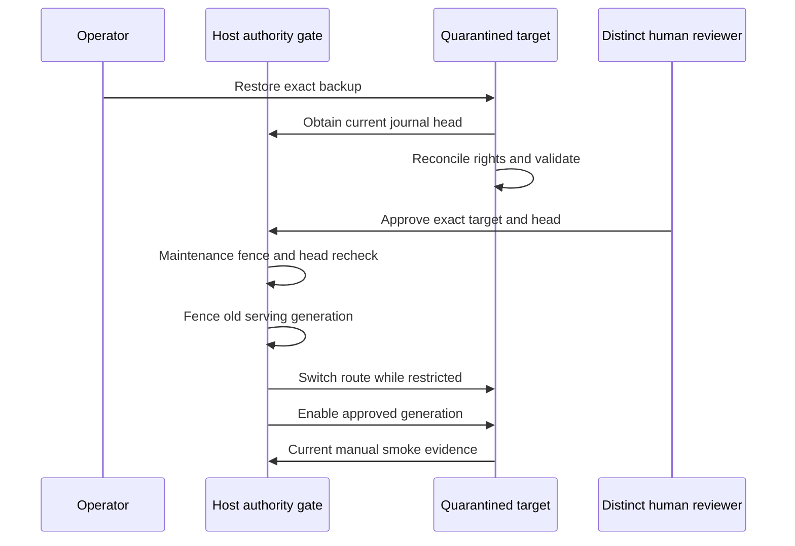

# Continuity, independent help, backup and serving recovery

## Capability and outage contract

AI-down permits current authorized manual conversation/records/referral. PDP/data/audit-down blocks normal protected effects; no buffered private success. Direct host help has own narrow authority/spool and static path, independent of core/model/policy/audit. Identity authority loss disables private help too, even if its host UI/spool is alive. Whole-host loss has no assured online capability; only previously cached public static content where available. A request acknowledgement/receiver receipt/accepted worker is never a staffed connection.

## Private help algorithm — DEC-02/A

Host help uses separate private origin/BFF session and current identity authority, no public private-data route. Create accepts locale and optional fictional jurisdiction only, no free-text story, PID, transcript or phone/address. Generate opaque request ID before authorization and canonical body digest. For each create/status/accept/cancel/reconcile, send authority `{operation_id,action,help_id,body_digest,nonce,browser_proof,deadline}` over authenticated workload channel. Authority resolves account/role current state and issues a signed request-specific one-use decision with identity/role revision, target/body/action/nonce and expiry≤original1000ms budget. It is not reusable permission or a cached-positive/offline grace exception.

Help checks exact receipt/audience/time/digest and its own owner/worker predicates, then consumes unique decision nonce and applies operation+local audit atomically in spool transaction. Acceptance CAS on request revision permits one eligible worker; state=accepted_unconnected, connection_confirmed=false. Status/retry gets fresh authority and current projection, never an old protected response. Authorization linearizes at fresh authority decision; subsequent bounded spool commit is an already-authorized in-flight operation, not atomic cross-store revocation. Revocation before decision denies; after it may be too late for that operation, and every subsequent operation revalidates. Missing/expired/uncertain decision denies private effect and shows independent static link.

Local spool audit is not canonical business audit. When core recovers, help sends minimal stable help ID/status/revision/local-event digest; core reauthorizes and deduplicates UNIQUE(help_id). Import creates/reconciles a request, never resurrects assignment, private history, old grants or connection. Keep original local/central times distinct. If identity service requires the failed core/audit/journal for its narrow help authority, private-help independence test fails; implement the dedicated identity-account/role predicate without protected business reads. Host root can affect help and core alike.

## Journal and backup protocol — DEC-04/B

Journal record contains format_version, journal_id/generation, total sequence, command ID, kind, explicit minimal restriction/scope payload, payload digest, previous hash, signature key ID/signature and durable timestamp. `restrict_intent` advances barrier; terminal db_commit_observed/checkpoint advances total tip only. `relax_intent` cannot grant until verified committed DB/review evidence; hold-release/regrant replay fails closed. Restriction payload includes exact affected identity/workload/consent/share/subject/service/control generations and reason, not merely a digest that cannot be replayed. Duplicate command ID+same digest returns durable status; changed digest conflicts. Append uses single host writer, expected-head CAS, fsync record+head and directory on rollover, with authenticated response. Torn/unverified tail quarantines until recovery establishes last durable valid record and whether any acknowledged intent is missing.

DB effect boundary compares fresh live barrier with applied barrier under control guard. Restrictive journal append success/DB rollback leaves a fence; recovery command idempotently applies restriction+audit then records observed completion. If append acknowledgement lost, inspect by command ID before deciding success or retry. Same-host journal availability is an intentional normal protected-service dependency. Head signature/clock/sequence alone does not prove recency after host rollback. Intact ongoing host authority is an assumption; suspected rollback/loss/root compromise keeps serving quarantined and requires a stronger environment decision.

Backup coordinator captures consistent encrypted DB snapshot/WAL recovery position, exact schema/artifact manifest, audit chain head, immutable capture time/expiry, object inventory and compatible live journal barrier. Identity DB backups are separate consistent captures and never revive sessions/tokens automatically; canonical access restrictions reconcile independently. Host help spool backup is separate. Store journal outside restored business volumes; back up it separately without ever replacing current journal with old business snapshot. Capture interval 60seconds and RPO60seconds/RTO300seconds are targets; a base snapshot schedule alone does not prove them. Verify decryption/integrity/object completeness and maintain latest recoverable position. Backup retry/restore never extends7day capture expiry.

## Restore and promotion state machine

1. Operator proposes exact backup/manifest under authorized recovery purpose. Create new target with no browser/receiver/model egress, unique credentials and network quarantine. Restore copy cannot serve or sign its own approval.
2. Validate backup integrity, schema/migration compatibility, audit chain/boundary checkpoints and object inventory. Mark corrupt/incomplete failed; preserve evidence. Fetch current live journal identity/head/barrier, verify continuing-host provenance and sequence continuity.
3. Reapply post-capture identity/consent/sharing revokes, tombstones, holds, kill/activation and serving restrictions. Unknown restrictive intent denies pending review. Do not restore bearer sessions, continuation tokens, leases, dispatch authorizations or review receipts as active. Reconcile uncertain sends by stable ID, never blindly execute old outbox. Restored positive consent/share grants are suspended by default until exact current commit/authority evidence outside the stale snapshot proves them or the subject explicitly regrants through normal authenticated flow; absent evidence never preserves old permission. Holds/deletions/revokes stay restrictive. Revalidate grants even if positive events were captured.
4. Seal validation manifest: target/snapshot/schema/artifact digests, journal ID/generation/head/barrier, current permissions/rights checks, uncertainty dispositions and next serving generation. Independently authorized human reviews exact target/evidence distinct from proposer/operator; approval expiry≤300seconds proposed. No automatic promotion from successful restore.
5. Enter short maintenance fence at live gate; block new protected operations/control mutations except emergency restriction admission. Compare exact approved target/head again. Any changed head/target—including a new restriction—invalidates approval and returns to validation/review. Expected maintenance records have separate deterministic promotion command lineage so the fence does not invalidate its own binding.
6. Host generation gate durably fences old generation before routing switch. Data final authorization AND dispatch AND edge admission require current host generation, not only DB/router config. Target remains restricted while routing changes. Verify exact route/target and publish target generation through an authenticated gate update. Crash in any gap leaves both generations blocked until reconciliation establishes a single serving generation.
7. Verify manual scoped smoke/current identity/audit/rights and mark serving. Admit AI separately. If smoke fails, restrict current generation, choose a compatible previously validated target under a new current approval; never simply flip to a stale old DB with older rights.

Host generation ledger and router/DB state are separate reconciled systems. Persist promotion steps `{proposed,approved,maintenance,fenced_old,routed_target,enabled_target,smoke_verified}` with target/generation digests; no cross-file/DB/router atomicity. On restart compare all three under restricted mode. A signed old restore approval or router file alone cannot establish serving authority. Record full recovery time through human approval and current-rights validation; report staffing/approval delay separately, never omit it to meet RTO.

## Runbooks and clocks

| Trigger | Immediate deterministic action / actor message | Reconcile and recovery evidence |
|---|---|---|
| Model timeout/slots unknown | Fence AI output, mark AI unavailable, retain manual service | Resolve compute jobs/bridge generation; per-function probe before readmission |
| PDP/audit/DB loss | Deny affected private operation, show unsubmitted/unknown truth | Restore dependency/current epoch/barrier; resolve operation keys before retry |
| Identity/issuer loss | No fresh private authority/new workload issuance; static remains | Validate current provider/trust, account fences, valid attested credentials; no expired-cert bypass |
| Poisoned feed / drift | Quarantine source/workload; current known alternatives or unknown | Reviewed correction, digest/network probes and current state |
| Account/workload compromise | Journalled scoped fence, terminate future events/work | Rotate credentials, inspect uncertain effects, human-authorized containment release |
| Overload | Bound inference/background, reserve urgent/manual capacity | Measure tail/error rates and alert; do not invent ETA or silently end cases |
| Unknown send/handoff | Preserve support, explicit unknown/unconnected | Receiver query/channel evidence; no duplicate new effect |
| Real-data contamination | Fence affected resources/evidence; no content copied into alerts | Authorized privacy/incident/rights handling; review before sanitized reuse |
| Failed candidate/cluster loss | Keep compatible LKG if healthy; direct help conditional on authority; static | Reconcile schema/artifact/generation, verify private paths before admission |
| Missing/suspect current head | Quarantine all protected serving | Accountable current-authority reconstruction; absent proof cannot be replaced by timestamp |

Measure separate input→response/actionable guidance/hazard/human-initiation clocks, policy decision, local revoke fence, propagation, detection, dashboard and alerts. Include timeouts/failures/missing observations, warm/cold model and sample/percentile method. First response≤2s p95, actionable≤5s p95, plan≤10s p99 and human-initiation≤10s p95 remain source targets; acknowledgement is not an actionable step or a connection. Incident review starts≤4hours target. No hard realtime or single-host availability certification.
