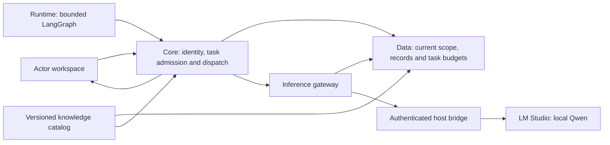

# Agentic workflows, local Qwen and clinical knowledge

Date: 2026-11-20. Authority: the user requested research, then explicitly instructed architecture, design, framework/resource acquisition, documentation and implementation. This decision advances the prior [Qwen integration proposal](2026-11-20-qwen-lm-studio-integration.md). It authorizes project-local source and dependency work, not deployment or clinical release.

## Service objective and architecture

GenAI prepares useful work for accountable actors: organize current reports, find relevant information, produce a source-linked briefing and prepare the next human decision. The system tracks task progress and actual handoff observations while retaining human and deterministic authority. The single-host private demo uses fictional patient/session data, no police integration, no autonomous emergency contact and no remote inference fallback.

Adopt LangGraph as a bounded orchestration library inside the isolated Runtime service. Core dispatches metadata for explicit authorized tasks; Runtime performs lease, inference and unsent proposal steps exclusively through the authenticated Core broker. Data owns durable counters, leases, fences, records and current context. Inference alone reaches the authenticated host bridge, which reaches fixed loopback LM Studio. A framework checkpointer does not replace or duplicate the task authority. No business DSN, patient corpus or model endpoint is given to Runtime.

Core's patient-independent knowledge lookup and Data's patient-bound retrieval use one immutable, network-free catalog library. Shared catalog code carries content filtering and integrity, not patient access authority. Data authorizes the session first, then selects applicable catalog entries using current permitted source text. Retrieved text stays attributed data, never approved instructions or executable policy.

## Selected implementation and alternatives

| Concern | Selected approach and reason |
|---|---|
| Orchestration | LangGraph 1.2.24, explicit small graph over existing broker ports; inspectable transitions and bounded termination |
| Model | Exact `qwen/qwen3.8-27b` through LM Studio; coordinated current-schema/default/fixture/source migration replaces the Gemma pin |
| Tokenizer | Host-only LM Studio SDK 1.5.0, already-loaded instance binding, actual template/tokenization and pre/post identity checks |
| Knowledge | Local closed catalog, metadata filtering before bounded lexical ranking; deterministic and inspectable baseline without another resident model |
| Grounding | Preserve exact attributed excerpts for the first worker release; the model selects evidence indices and the gateway reconstructs the full proposal from server context, while human review handles edits. Free-form clinical synthesis requires its own evidence |
| Workflow initiation | Explicit worker command or unchecked, in-memory opt-in in a workspace bound to account and session; no autonomous new task creation by the model |
| Persistence | Existing encrypted Data task/draft/observation ledgers; graph state holds references/status, no independent cross-client memory |
| Effects | Existing exact-payload human review plus separate current domain command; no graph-owned dispatch or consent grant |

A general autonomous-agent harness would enlarge tool and network authority without a demonstrated benefit. Pydantic AI is a credible typed alternative, but adding a second orchestration framework is unnecessary here. Dense embeddings/reranking may improve recall; this baseline makes no semantic/vector-search claim. Evaluate them against the lexical baseline before adding dependency, memory and disclosure costs. FHIR remains an interchange/knowledge representation option, not a replacement for current domain authorization.

## Actor journeys and current delivery boundary

The worker opts into preparation for the current assigned session. Core admits one task and queues references. Runtime claims the reference under its workload identity; Data checks the current actor/session/catalog, reserves bounded work and supplies context. The model selects server-labelled evidence indices using a compact closed schema. Inference reconstructs the unsent proposal, task bindings, source references and exact text from trusted request/context data; Inference and Core validate the full canonical proposal. The model does not copy authority metadata or invent factual prose. The worker sees attributed patient reports separately from reference guidance, edits/rejects/accepts the exact draft, and continues normal service independently of AI.

Role-scoped knowledge lookup serves PID, carer, professional participant, worker, receiver and supervisor from a patient-independent corpus. The task-generating actor workflow remains `worker_summary / prepare_summary / draft_ready` initially. Receiver acceptance, referral dispatch, supervisor reassignment and client-visible free-text clinical generation are not added by naming these roles. A complete cross-role referral automation graph remains a separately scoped extension of these working boundaries.

Automatic preparation is optional, tied to the current authenticated account/session and source revision, and subject to existing function admission. It does not create work before opt-in, retry an uncertain mutation with a new key or renew authority after a role change. Read-only polling is bounded. The UI displays missing/uncertain information and source metadata rather than hidden reasoning. An unavailable model leaves manual service usable.

## Knowledge and clinical resources

The initial runtime catalog contains authored fictional administrative workflow guidance in EN/FR and attributed reference-only paraphrases of Ontario Health's major-depression shared-decision statement. The latter are restricted to professional/worker retrieval, include guideline population/exclusions, and do not establish diagnosis, treatment or applicability to an individual. French paraphrases are not represented as publisher translations or independently language-reviewed material. `verification=verified` establishes catalog byte integrity only; no clinical review is fabricated.

[Source registry](../../config/demo/knowledge/reference-sources.json) records exact URLs, retrieval date, local snapshots and hashes for Ontario Health, HL7 FHIR, OWASP and NIST. [Runtime catalog](../../config/demo/knowledge/catalog.json) is separate from these research snapshots. Runtime never browses these URLs or imports documents automatically. Publisher terms and source versions are retained. A curator must explicitly produce a new catalog revision; expired or changed knowledge invalidates pending use.

The canonical demo jurisdictions are synthetic CA-XX/CA-YY. [Scenario binding](../../config/demo/knowledge/scenario-binding.json) explicitly maps fictional CA-XX to the CA-ON reference collection for the authored demo. It is not inferred geography or permission to treat CA-YY as Ontario. Missing binding denies patient-bound knowledge use.

## Security, safety and continuity

Actor, workload, task and purpose remain distinct. Every runtime call passes through the broker and current Data checks. Catalog filters apply before ranking; reference-only clinical entries cannot enter PID/carer/receiver/supervisor results. Neither source content nor model text can choose recipients, widen scope, register tools, approve itself or change live policy.

The metadata queue is bounded and ephemeral. Losing Core custody or a poll response may leave a task unexecuted; an actor must retry/revise explicitly. Durable leases/fences/counters prevent replay from minting budgets. Generation timeout does not establish provider stop and does not release occupied compute without observed completion or verified recovery. Framework retries and graph restart do not reset authority.

Retain 8192 context, at most1024 output, 30-second generation,120-second task, four-step/three-tool/two-proposal ceilings. Initial operational guidance is one active generation despite the loaded server advertising four parallel slots. Real tests decide whether a function fits. No four-slot capacity or mission-critical whole-host availability is claimed.

Security controls follow the threat classes in [OWASP Agentic Top10 2026](https://genai.owasp.org/resource/owasp-top-10-for-agentic-applications-for-2026/) and [Securing Agentic Applications V2](https://genai.owasp.org/resource/securing-agentic-applications-v2/). Injection resistance requires deterministic action restrictions and data isolation, not a promise that prompts prevent all attacks. Clinical factual quality, applicability and operational continuity need separate evidence from security denials.

## Verification and release

Verify role/locale/jurisdiction/expiry filters, catalog/source mutation, task/cancel/review races, forged clinical instructions, exact source grounding, budget/lease/replay behavior, unknown compute, EN/FR/keyboard/accessibility and manual continuity. Compare total preparation plus correction effort with manual work in later human evaluation. Direct Qwen synthetic tests must report actual model/engine/template/tokenizer/artifact identity, output/schema/grounding and elapsed time. A passing connectivity or component test does not qualify G-06 or enable all functions.

The [session003 handoff and results](../IMP/slices/IMP-06-bounded-ai-assistance/sessions/003-agentic-workflows-rag/) record actual implementation and checks, including failures and unrun qualification. Historical session001/002 records are not rewritten as Qwen/LangGraph evidence.

Research basis: [LangGraph workflow patterns](https://docs.langchain.com/oss/python/langgraph/workflows-agents), [interrupt replay semantics](https://docs.langchain.com/oss/python/langgraph/interrupts), [NCSC prompt-injection design](https://www.ncsc.gov.uk/blog-post/prompt-injection-is-not-sql-injection), [secure agent design research](https://arxiv.org/abs/2506.08837), [MIRAGE medical RAG benchmark](https://arxiv.org/abs/2402.13178), [CARE-RAG reasoning evaluation](https://arxiv.org/abs/2511.15994), [clinical documentation RCT](https://pmc.ncbi.nlm.nih.gov/articles/PMC12768499/). Research informs selection; it does not validate this local model or clinical deployment.

## Actual provider compatibility findings

The installed MLX grammar compiler rejected the generic Proposal schema's `uniqueItems` and tool `oneOf` constructs. A narrower source-selection schema keeps authority fields and tool unions outside model output. The full canonical validator still checks the reconstructed proposal, duplicate/invalid indices are denied locally, and all critical patient assertion indices must be preserved. Canonical, wire and implementation digests are recorded separately. Reasoning-only output under the initial template is a failed case, not a function pass. A non-thinking request is usable only when actual server template rendering/tokenization matches the provider's prompt count. Session evidence records actual results and any residual limits.

A later real-model run passed four EN/FR baseline/injection cases using the exact local Ontario Health reference entries and fictional adult records, with matching token counts and zero reasoning tokens. Full receipts, failed earlier attempts and source binding are in session003. This is a narrow technical/grounding result; it is not evidence of clinical suitability, workload-scale latency or deployed role isolation. The typed renderer depends on pinned SDK internals/vendor keys and fails closed on compatibility drift.
